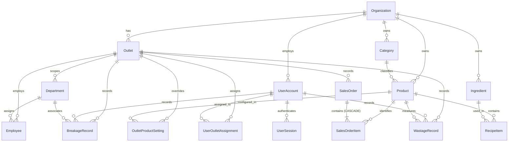
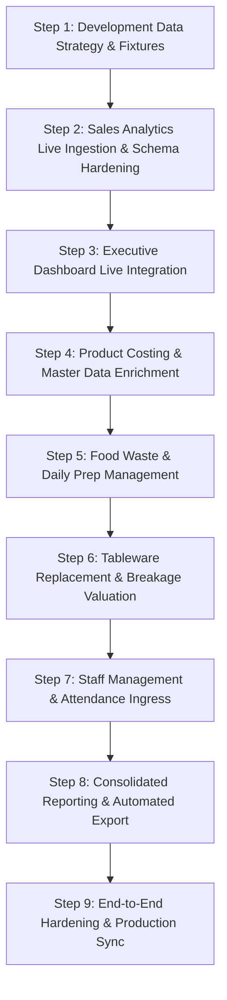

# Ashirvad Gulmohar Restaurant Analytics & Management System
## Current Application Audit and Development Roadmap

> **Classification:** Technical Architecture Audit, Proposal Gap Analysis & Implementation Roadmap  
> **Status:** Completed Inspection & Planning Document  
> **Date:** 20 November 2026  
> **Scope:** Full-stack codebase audit (`src/app`, `src/components`, `src/lib`, `prisma/schema.prisma`, `tmp/petpooja-sample-2026-11-17.json`). No source code, database tables, or environment configs modified.

---

## 1. Executive Summary

The production infrastructure on the Hostinger VPS (Ubuntu 24.04.5 LTS) has been established:
- **HTTPS & Web Serving:** Configured via Nginx reverse proxy routing to `127.0.0.1:8100` (`gulmohar-analytics` container).
- **Production Database:** PostgreSQL 16 database `gulmohar_analytics` running in `shared-postgres` container on Docker network `shared-db-net`.
- **Production Master Bootstrap:** Successfully executed via `prisma/seeds/seed.prod.ts` on 20 November 2026, creating organization `AG` (`Ashirvad Gulmohar`), production outlet `KOZ-001` (`Ashirvad Gulmohar - Kozhikode 1`), operational departments `D01` (Kitchen) and `D02` (Service), and initial administrator `admin` (hashed via Argon2id) mapped with default outlet access.
- **Petpooja Pipeline Readiness:** Stages 1 through 3D (API client, normalizer, resolver, ingestion service, and sync orchestrator) have been implemented and verified with 54 passing automated tests. A live read-only pull previously returned 507 orders for operational date `2026-11-17` from Petpooja restaurant ID `9780nusx`.

This audit assesses the entire application against the approved **Ashirvad Gulmohar Restaurant Analytics & Management System Proposal**, establishes a concrete local development data strategy, identifies all UI and backend gaps, and provides a dependency-ordered engineering roadmap.

---

## 2. Frontend and UI Audit

### 2.1 Route Inventory & Visual Hierarchy

The application frontend is structured using Next.js 16 App Router with Tailwind CSS v4, shadcn/ui (Radix primitives), and Lucide icons.

| Route | Page File | Access Level (RBAC) | Current Presentation & Layout | Data Source Active |
| :--- | :--- | :--- | :--- | :--- |
| `/login` | `src/app/login/page.tsx` | Public | Centered login card with username & password fields, error toasts, and returnUrl redirection. | PostgreSQL (`user_accounts`, `user_sessions`, `login_attempts`) |
| `/dashboard` | `src/app/dashboard/page.tsx` | Admin | Executive summary grid: 5 top KPI tiles, Sales & Orders trend chart, Category Performance, Top Items, Attention Needed items, Prep/Wastage overview, Manpower tile, Breakage tile, Management Attention feed. | Dual-mode: Reads DB when `DATA_SOURCE=database` for sales/wastage/breakage; mock baseline for prep/attendance/operating costs. |
| `/dashboard/sales` | `src/app/dashboard/sales/page.tsx` | Admin | 6 KPI tiles, Sales & Orders trend chart, Hourly Sales bar chart, Payment Method pie chart, Order Type breakdown, Category Performance, Full Product Performance table with pagination/search. | Dual-mode: Reads DB for sales summary and product volume; mock baseline for hourly, payment method, order type. |
| `/dashboard/profitability` | `src/app/dashboard/profitability/page.tsx` | Admin | 4 KPI tiles (Revenue, Food Cost, Gross Margin, Margin %), Profitability Matrix scatter chart, 3 classification tables (Loss-making, High-sales/low-margin, Low-sales/low-margin), Full Product Profitability table. | Dual-mode: Reads DB when `DATA_SOURCE=database` via `products`, `outlet_product_settings`, and `sales_order_items`. |
| `/dashboard/wastage` | `src/app/dashboard/wastage/page.tsx` | Admin, Manager | 6 KPI tiles (Prepared, Sold, Wasted qty, Wastage %, Wastage Cost), Prep-vs-Sold-vs-Wasted trend, Wastage % trend, Wastage by Product bar chart, Wastage by Reason chart, Wastage Detail table, **Interactive PostgreSQL Wastage Records Section**. | Hybrid: Upper charts read mock baseline; lower records table reads live PostgreSQL `/api/dashboard/wastage` with interactive modal CRUD. |
| `/dashboard/manpower` | `src/app/dashboard/manpower/page.tsx` | Admin | 6 KPI tiles (Total Employees, Present, Absent, On Leave, Attendance Rate, Monthly Labor Cost), 30-day Attendance Trend, Department Headcount, Actual vs Benchmark staffing, Department Staffing table. | Mock JSON exclusively (`attendance.json`, `employees.json`, `departments.json`). |
| `/dashboard/breakage` | `src/app/dashboard/breakage/page.tsx` | Admin, Manager | 4 KPI tiles (Total Cost, Event Count, Avg Cost/Event, Highest Cost Dept), Breakage by Department chart, Breakage by Item chart, Breakage Detail table, **Interactive PostgreSQL Breakage Records Section**. | Hybrid: Upper charts read mock baseline; lower records table reads live PostgreSQL `/api/dashboard/breakage` with interactive modal CRUD. |
| `/dashboard/reports` | `src/app/dashboard/reports/page.tsx` | Admin | Period comparison matrix, high-level summary cards, top product lists, interactive CSV export controls (`ReportExportControls`), print stylesheet support. | Composed analytics layer (inherits active DB/mock state from underlying loaders). |
| `/dashboard/master-data` | `src/app/dashboard/master-data/page.tsx` | Admin | Tabbed Master Data Management dashboard (`Departments`, `Products & Menu`, `Ingredients`, `Recipes`). Modal creation/editing with active status toggle. | Live PostgreSQL (`/api/admin/*`). |
| `/operator/entry` | `src/app/operator/entry/page.tsx` | Operator, Manager, Admin | Streamlined, financial-free floor data entry portal (`OperatorPortal`). Tabbed entry for Kitchen Food Waste and Tableware Breakage. | Live PostgreSQL (`/api/operator/*`). Strict server-side cost calculation; zero price inputs shown to floor operators. |

### 2.2 UI Component Classification & Analysis

#### A. Components Already Connected to Live PostgreSQL Backend
- **Header Outlet Selector (`src/components/layout/outlet-selector.tsx`):** Calls `/api/dashboard/outlets` to dynamically display the user's assigned outlets or organization-wide switcher for Admin.
- **Wastage Records Section (`src/components/dashboard/wastage-records-table.tsx`):** Live data table querying `/api/dashboard/wastage` with create/edit/delete dialogs (`wastage-form-dialog.tsx`), pagination, and date filtering.
- **Breakage Records Section (`src/components/dashboard/breakage-records-table.tsx`):** Live data table querying `/api/dashboard/breakage` with create/edit/delete dialogs (`breakage-form-dialog.tsx`).
- **Master Data Dashboard (`src/components/admin/master-data-dashboard.tsx`):** Full CRUD across departments, products, ingredients, and recipes via `/api/admin/*`.
- **Operator Floor Portal (`src/components/operator/operator-portal.tsx`):** Floor entry form with product/department auto-complete, quantity inputs, and submission to `/api/operator/wastage` and `/api/operator/breakage`.

#### B. Components Consuming Analytics Layer (Dual-Mode Capable)
- **KPI Metric Cards (`MetricCard` in `src/components/dashboard/ui-kit.tsx`):** Used universally across all pages. Supports raw values, subtitle metadata, delta percentages, and comparison labels.
- **Sales Performance Chart (`sales-performance-chart.tsx`):** Recharts composed bar (sales) and line (orders) chart. Works in DB mode when orders exist.
- **Category Performance Chart (`category-performance-chart.tsx`):** Horizontal bar chart mapping sales revenue by category.
- **Product Performance Table (`product-performance-table.tsx`):** Paginated, searchable sales table showing item quantity, gross revenue, category, and average price.
- **Profitability Matrix Chart (`profitability-matrix-chart.tsx`):** Scatter plot visualizing product margin % vs sales volume.
- **Report Export Controls (`report-export-controls.tsx`):** Client-side CSV generation reading server-composed metrics with NULL-safe financial formatting.

#### C. Components Currently Bound to Static Mock JSON Baselines
- **Hourly Sales Chart (`hourly-sales-chart.tsx`):** Currently reads `getHourlySales()`. While `SalesOrder.orderedAt` stores order time in PostgreSQL, `getHourlySales` is not yet connected to aggregate from Prisma.
- **Payment Method Chart (`payment-method-chart.tsx`):** Currently reads `getSalesByPaymentMethod()`. The database schema currently lacks a `paymentType` column on `SalesOrder` (it is present in Petpooja payload as `Order.payment_type` and `Order.part_payment[]`, but deferred in schema).
- **Order Type Chart (`order-type-chart.tsx`):** Reads `getSalesByOrderType()`. While `SalesOrder.orderType` exists in PostgreSQL, the aggregator currently consumes mock sales data.
- **Food Prep & Wastage Chart (`food-prep-wastage-chart.tsx`, `prep-vs-sold-vs-wasted-chart.tsx`):** Bound to `preparation.json` (only 8 products tracked in mock data). Daily batch preparation is not yet tracked in PostgreSQL.
- **Manpower & Attendance Charts (`attendance-trend-chart.tsx`, `department-headcount-chart.tsx`, `actual-vs-benchmark-chart.tsx`):** Bound to `attendance.json` and `employees.json`. Daily biometric attendance logs are not yet stored in PostgreSQL.

---

## 3. Backend and Database Audit

### 3.1 Relational Schema & Entity Relationship Map

The Prisma schema (`prisma/schema.prisma`) defines 17 models and 3 enums across 6 logical domains:



### 3.2 Implementation Status by Database Model

| Prisma Model | Physical Table | Migration Status | Backend API Connected | Implementation Completeness | Notes & Gaps |
| :--- | :--- | :--- | :--- | :--- | :--- |
| `Organization` | `organizations` | Applied | Read-only in Auth & Admin | **Complete (Phase 1)** | Multi-tenant root entity (`AG`). |
| `Outlet` | `outlets` | Applied | `/api/dashboard/outlets` | **Complete (Phase 1)** | `petpoojaRestId` mapped to `9780nusx` for `KOZ-001`. |
| `UserAccount` | `user_accounts` | Applied | `/api/auth/*` | **Complete (Phase 1)** | Roles: `admin`, `manager`, `operator`. Argon2id hash. |
| `UserSession` | `user_sessions` | Applied | Auth Middleware / Session | **Complete (Phase 1)** | Server-side token hashing and instant revocation. |
| `LoginAttempt` | `login_attempts` | Applied | Auth Rate Limiter | **Complete (Phase 1)** | Exponential lockouts on brute-force attempts. |
| `UserOutletAssignment` | `user_outlet_assignments` | Applied | `/api/dashboard/outlets` | **Complete (Phase 1)** | Maps users to outlets with `isDefault` flag. |
| `Department` | `departments` | Applied | `/api/admin/departments` | **Complete (Phase 1)** | Scoped to outlet. `benchmarkHeadcount` supported. |
| `Employee` | `employees` | Applied | Read in `src/lib/data/employees.ts` | **Partially Implemented** | Directory exists; no admin UI for staff additions; attendance decoupled. |
| `Category` | `categories` | Applied | `/api/admin/products` | **Complete (Phase 1)** | Display order and organization scoping operational. |
| `Product` | `products` | Applied | `/api/admin/products` | **Complete (Phase 1)** | Strict NULL-cost policy for missing food costs. |
| `Ingredient` | `ingredients` | Applied | `/api/admin/ingredients` | **Complete (Phase 1)** | Unit cost tracking operational. |
| `RecipeItem` | `recipe_items` | Applied | `/api/admin/recipes` | **Complete (Phase 1)** | BOM mapping dish $\to$ ingredient $\times$ quantity. |
| `OutletProductSetting` | `outlet_product_settings` | Applied | `/api/admin/products` | **Complete (Phase 1)** | Outlet price overrides and `petpoojaItemId` mapping. |
| `WastageRecord` | `wastage_records` | Applied | `/api/dashboard/wastage`, `/api/operator/wastage` | **Complete (Phase 1)** | Server-side food cost lookup from product master. |
| `BreakageRecord` | `breakage_records` | Applied | `/api/dashboard/breakage`, `/api/operator/breakage` | **Complete (Phase 1)** | Tableware replacement cost is nullable (no master). |
| `SalesOrder` | `sales_orders` | Applied | `src/lib/data/sales.ts`, Ingestion Service | **Complete (Phase 1)** | Upsert key `(outletId, petpoojaOrderId)`. Status: Success/Cancelled. |
| `SalesOrderItem` | `sales_order_items` | Applied | `src/lib/data/sale-items.ts`, Ingestion Service | **Complete (Phase 1)** | Nullable `productId` for unmapped POS items. |

### 3.3 Missing Database Tables for Future Phases
The following models are referenced in the approved proposal but intentionally excluded from Phase 1:
1. `tableware_items`: Replacement cost catalog for crockery/glassware (tableware breakage currently uses free-text item names and stores `unit_cost: null`).
2. `preparation_logs`: Daily batch cooking logs (prep tracking currently reads `preparation.json`).
3. `attendance_logs`: Daily biometric punch in/out timestamps (attendance currently reads `attendance.json`).
4. `operating_expenses`: General ledger overhead entries for rent, power, and gas.

---

## 4. Petpooja Integration Audit

### 4.1 Response Structure (Based on Sanitized Live Sample `2026-11-17`)

Inspection of `tmp/petpooja-sample-2026-11-17.json` (507 actual orders from Kozhikode outlet `9780nusx`) confirms the following field mapping and support status:

```
Petpooja Get Orders Payload
├── Restaurant
│   ├── restaurantid: "57175"
│   ├── res_name: "GULMOHAR RESTAURANT"
│   ├── restID: "9780nusx" ───────────────► Mapped to Outlet.petpoojaRestId
├── Customer (Redacted / PII Masked)
│   ├── name, phone, address, gst_no ─────► Redacted; PII excluded from database
├── Order
│   ├── orderID: "58322" ─────────────────► Mapped to SalesOrder.petpoojaOrderId
│   ├── order_date: "2026-11-17" ─────────► Mapped to SalesOrder.orderDate (@db.Date)
│   ├── created_on: "2026-11-17 22:35:41" ► Parsed IST -> UTC -> SalesOrder.orderedAt (@db.Timestamptz)
│   ├── order_type: "Dine In" ────────────► Mapped to SalesOrder.orderType
│   ├── status: "Success" ────────────────► Mapped to SalesOrder.status ("Success" | "Cancelled")
│   ├── core_total: "1032" ───────────────► Mapped to SalesOrder.coreTotal (Decimal 12,2)
│   ├── tax_total: "51.6" ────────────────► Mapped to SalesOrder.taxTotal (Decimal 12,2)
│   ├── discount_total: "0" ──────────────► Mapped to SalesOrder.discountTotal (Decimal 12,2)
│   ├── total: "1084" ────────────────────► Mapped to SalesOrder.totalAmount (Decimal 12,2)
│   ├── payment_type: "Cash" ─────────────► NOT stored in SalesOrder (Schema Gap)
│   ├── table_no: "C5" ───────────────────► NOT stored in SalesOrder
│   ├── no_of_persons: "2" ───────────────► NOT stored in SalesOrder
│   ├── biller_name: "RAHUL" ─────────────► NOT stored in SalesOrder
│   └── part_payment: [] ─────────────────► NOT stored in SalesOrder
├── OrderItem[]
│   ├── itemid: "1318297226" ─────────────► Resolved via OutletProductSetting.petpoojaItemId
│   ├── itemcode: "110" ──────────────────► Resolved via Product.productCode (fallback)
│   ├── name: "Butter Roti" ──────────────► Mapped to SalesOrderItem.itemName
│   ├── price: "48" ──────────────────────► Mapped to SalesOrderItem.unitPrice (Decimal 10,2)
│   ├── quantity: "4" ────────────────────► Mapped to SalesOrderItem.quantity (Decimal 10,3)
│   ├── total: "192" ─────────────────────► Mapped to SalesOrderItem.totalAmount (Decimal 12,2)
│   ├── total_tax: 9.6 ───────────────────► Mapped to SalesOrderItem.itemTax (Decimal 10,2)
│   ├── total_discount: 0 ────────────────► Mapped to SalesOrderItem.itemDiscount (Decimal 10,2)
│   └── addon: [] ────────────────────────► Flattened / Not individually stored
```

### 4.2 Product Resolution Hierarchy
The resolver (`src/lib/petpooja/resolver.ts`) enforces the following resolution hierarchy:
1. **Outlet-Specific Mapping:** Matches `OrderItem.itemid` against `OutletProductSetting.petpoojaItemId` for the resolved outlet.
2. **Organization-Level Fallback:** If unmapped, matches `OrderItem.itemcode` against `Product.productCode` within the outlet's parent organization.
3. **Safe Unmapped Ingestion:** If neither matches, the order is **not** aborted; the line item is persisted with `productId: null` while preserving the exact POS item name, quantity, unit price, tax, and line total.

### 4.3 Financial Integrity & Precision Rules
- **Decimal Representation:** All monetary values use `Prisma.Decimal` to avoid floating-point rounding errors.
- **Strict Nullability:** Missing monetary values remain `NULL`, never forced to `0.00`.
- **Cancellation Isolation:** Cancelled orders (`status: "Cancelled"`) are stored in `sales_orders` to preserve the complete audit trail, but are strictly excluded by `getSales()` (`where: { status: "Success" }`) so they never inflate gross/net revenue.

---

## 5. Development Data Strategy

A robust local development dataset is required so engineering, testing, and UI refinements can proceed without depending on ad-hoc production exports or compromising real customer privacy.

### 5.1 Architecture of the Development Seed Dataset
The development data strategy is divided into two cleanly separated tiers:

```
[Development Data Strategy]
├── Tier 1: Real-World POS Sales Fixtures (Sanitized Petpooja Orders)
│   ├── Sourced from actual verified Petpooja Get Orders response (2026-11-17)
│   ├── Redacted: Customer names, phone numbers, addresses, GSTIN numbers
│   ├── Synthesized across a 14-day rolling operational window (e.g., Nov 4 to Nov 17, 2026)
│   ├── Covers 500+ orders/day with real menu items:
│   │   - Meals, Mini Meals, Butter Roti, Paneer Nirvana, South Indian staples
│   │   - Exact tax breakdowns (CGST 2.5%, SGST 2.5%), discounts, and round-offs
│   │   - Realistic payment types: Cash, UPI, Credit Card, Split Tender
│   │   - Realistic order types: Dine In, Takeaway, Delivery
│   └── Enables genuine testing of the Petpooja Ingestion Service and Sales Analytics
│
└── Tier 2: Consistent Operational Master & Baseline Data
    ├── Organization: "AG" (Ashirvad Gulmohar)
    ├── Outlets:
    │   - "KOZ-001" (Ashirvad Gulmohar - Kozhikode 1, petpoojaRestId: "9780nusx")
    │   - "KOZ-002" (Kozhikode Test/Dev Outlet - Dev only, never in prod)
    ├── Menu Catalog: 60 realistic South Indian & Vegetarian dishes with standard food costs
    ├── Ingredients & Recipes: 41 ingredients linked to recipes for core items (Meals, Biryani, Curries)
    ├── Staff Directory: 55 employees across 6 departments (Kitchen, Service, Cleaning, etc.)
    ├── Daily Preparation Logs: 14 days of tracked batch preparation for high-volume items
    ├── Wastage Records: 14 days of realistic kitchen waste records linked to user accounts
    └── Breakage Records: 14 days of tableware breakage entries across departments
```

### 5.2 Development Seed Execution Rules
1. **Target Isolation:** Development fixtures must **only** be executed via `npm run db:seed` (`tsx prisma/seeds/seed.dev.ts`).
2. **Production Immunity:** `seed.dev.ts` includes an unbreakable environment check:
   ```typescript
   if (process.env.NODE_ENV === "production" || process.env.DATABASE_URL?.includes("gulmohar_analytics")) {
     throw new Error("Refusing to execute development seed against production database.");
   }
   ```
3. **Deterministic Timestamps:** Fixture timestamps must generate valid ISO dates anchored to operational business days (`YYYY-MM-DD`).

---

## 6. Detailed Module Gap Analysis (Against Approved Proposal)

### 6.1 Executive Dashboard

| Dimension | Audit Finding |
| :--- | :--- |
| **Frontend Implementation** | Implemented in `src/app/dashboard/page.tsx`. Renders KPI cards, sales trends, category bars, top items, attention items, prep/wastage summary, manpower tile, breakage tile, and management notifications. |
| **Backend Implementation** | Composed in `src/lib/analytics/summary.ts` via `getOperationalContributionForRange()`, `getSalesSummary()`, `getProductProfitability()`. |
| **Database Readiness** | Sales, Wastage, Breakage, Products, and Categories read from PostgreSQL in DB mode. Preparation, Attendance, and Operating Costs read from baseline mock loaders. |
| **Data Dependencies** | Requires active sales orders, product catalog, wastage logs, and breakage logs. |
| **Missing Features** | Hourly distribution drilldown is missing; operational contribution currently lacks a live general ledger overhead table. |
| **Testing Requirements** | Verify that switching `DATA_SOURCE=database` renders live sales without `NaN` or unhandled exceptions when certain loss components have null costs. |

---

### 6.2 Sales Analytics

| Dimension | Audit Finding |
| :--- | :--- |
| **Frontend Implementation** | Implemented in `src/app/dashboard/sales/page.tsx`. Renders net sales, order counts, AOV, quantity, discount KPIs, hourly sales chart, payment method chart, order type chart, category performance, and full product sales table. |
| **Backend Implementation** | `src/lib/analytics/sales.ts` provides `getSalesSummary()`, `getSalesTrend()`, `getHourlySales()`, `getSalesByOrderType()`, `getSalesByPaymentMethod()`. |
| **Database Readiness** | `getSales()` and `getSaleItems()` in `src/lib/data/` support both mock and PostgreSQL modes. |
| **Data Dependencies** | `SalesOrder` and `SalesOrderItem` tables populated via Petpooja sync. |
| **Missing Features** | **Payment Method Aggregation Gap:** `SalesOrder` currently lacks `payment_type` in the Prisma schema. The Petpooja API returns `Order.payment_type` ("Cash", "Card", "UPI"), but it is not stored in PostgreSQL. Hourly sales aggregation currently runs on mock data rather than grouping `SalesOrder.orderedAt` by hour. |
| **Testing Requirements** | Verify date-range filtering, comparison deltas ("vs previous period"), and category/product sales reconciliation against Petpooja Z-reports. |

---

### 6.3 Profitability Analysis

| Dimension | Audit Finding |
| :--- | :--- |
| **Frontend Implementation** | Implemented in `src/app/dashboard/profitability/page.tsx`. Renders Revenue, Food Cost, Gross Food Margin, Margin %, Profitability Matrix scatter chart, and 3 classification tables (Loss-making, High-sales/low-margin, Low-sales/low-margin). |
| **Backend Implementation** | `src/lib/analytics/profitability.ts` computes unit margins, food costs, and margin classifications using formulas from `business-rules.md`. |
| **Database Readiness** | Fully supported in DB mode. `getProducts()` reads `products.food_cost` and `outlet_product_settings.price_override`. `getSaleItems()` supplies quantities sold. |
| **Data Dependencies** | Relies on `Product.foodCost` being populated in Master Data. |
| **Missing Features** | Dynamic ingredient price variance tracking (changes in raw vegetable/oil costs do not automatically update recipe food costs; food cost is currently a static master field on `Product`). |
| **Testing Requirements** | Strict NULL-cost testing: uncosted dishes must show `grossMargin: null` and be excluded from loss-making/high-profit lists without crashing. |

---

### 6.4 Food Preparation and Wastage

| Dimension | Audit Finding |
| :--- | :--- |
| **Frontend Implementation** | Implemented in `src/app/dashboard/wastage/page.tsx`. Upper section displays KPIs, prep vs sold trends, wastage % trends, product/reason charts, and wastage detail table. Lower section provides interactive PostgreSQL CRUD records table. |
| **Backend Implementation** | Analytics in `src/lib/analytics/preparation.ts` and `wastage.ts`. Live CRUD API endpoints implemented at `/api/dashboard/wastage` and `/api/operator/wastage`. |
| **Database Readiness** | `WastageRecord` table is fully active in PostgreSQL with relations to `Outlet`, `Product`, and `UserAccount`. `preparation_logs` table does not exist in PostgreSQL. |
| **Data Dependencies** | Upper analytics depend on `preparation.json` (covers only 8 products). Lower table depends on `WastageRecord`. |
| **Missing Features** | **Prep Log Gap:** No PostgreSQL table or UI exists for daily kitchen batch preparation logs (e.g. logging that 200 Idlis or 50 Meals were cooked in the morning). Currently, preparation data is simulated via mock JSON. |
| **Testing Requirements** | Verify that operator entries logged at `/operator/entry` immediately appear in the Manager Wastage Records Table and that server-side food cost valuation computes accurately. |

---

### 6.5 Manpower and Attendance

| Dimension | Audit Finding |
| :--- | :--- |
| **Frontend Implementation** | Implemented in `src/app/dashboard/manpower/page.tsx`. Renders headcount, present/absent/leave counts, attendance rate, monthly labor cost estimate, 30-day attendance trend, department staffing vs benchmarks, and employee detail table. |
| **Backend Implementation** | `src/lib/analytics/manpower.ts` and `attendance.ts` read `employees.json`, `attendance.json`, and `departments.json`. |
| **Database Readiness** | `Department` and `Employee` tables exist in PostgreSQL. Daily attendance swipe logs (`attendance_logs`) do not exist in PostgreSQL. |
| **Data Dependencies** | Entirely dependent on mock files. `src/lib/data/attendance.ts` returns mock data regardless of `DATA_SOURCE`. |
| **Missing Features** | Biometric fingerprint/facial machine integration is completely absent. No manual attendance entry interface exists for floor managers. Employee master management has no frontend UI. |
| **Testing Requirements** | Attendance analytics verification against benchmark headcounts; labor cost aggregation based on monthly salary bands. |

---

### 6.6 Breakage Management

| Dimension | Audit Finding |
| :--- | :--- |
| **Frontend Implementation** | Implemented in `src/app/dashboard/breakage/page.tsx`. Upper section displays total cost, event count, avg cost/event, highest cost dept, department bar chart, item bar chart, and detail table. Lower section provides live interactive PostgreSQL CRUD records table. |
| **Backend Implementation** | Analytics in `src/lib/analytics/breakage.ts`. Live CRUD API endpoints implemented at `/api/dashboard/breakage` and `/api/operator/breakage`. |
| **Database Readiness** | `BreakageRecord` table is fully active in PostgreSQL with relations to `Outlet`, `Department`, and `UserAccount`. |
| **Data Dependencies** | Upper analytics consume mock baseline; lower table consumes PostgreSQL `breakage_records`. |
| **Missing Features** | **Tableware Catalog Gap:** `BreakageRecord.item` is a free-text string. There is no `tableware_items` master table. As a result, unit replacement costs cannot be verified server-side and are currently stored as `unit_cost: null`. |
| **Testing Requirements** | Verify that operator breakage logging works without price inputs, department scoping restricts records to valid outlet departments, and total cost calculates safely when costs are null. |

---

### 6.7 Reports

| Dimension | Audit Implementation |
| :--- | :--- |
| **Frontend Implementation** | Implemented in `src/app/dashboard/reports/page.tsx`. Period comparison matrix, high-level summary cards, top product lists, interactive CSV export controls (`ReportExportControls`), print stylesheet support. |
| **Backend Implementation** | Composed in `getReportsPageData()` combining sales, food margins, wastage, breakage, and manpower. |
| **Database Readiness** | Ready in DB mode. Composes live PostgreSQL data for sales, product margins, wastage, and breakage. |
| **Data Dependencies** | Inherits underlying data sources. |
| **Missing Features** | PDF export is currently a prototype trigger with a toast notification; scheduled automated email dispatch is not implemented. |
| **Testing Requirements** | Verify CSV export output against raw database rows; ensure missing/null costs output `"Incomplete"` rather than false `"0.00"`. |

---

### 6.8 Data Entry & Administration

| Dimension | Audit Implementation |
| :--- | :--- |
| **Frontend Implementation** | Dedicated Operator Entry portal at `/operator/entry` and Admin Master Data at `/dashboard/master-data`. |
| **Backend Implementation** | API routes at `/api/operator/*` and `/api/admin/*` enforcing strict role boundaries and server-side cost resolution. |
| **Database Readiness** | Fully supported across `WastageRecord`, `BreakageRecord`, `Department`, `Product`, `Ingredient`, `RecipeItem`, `OutletProductSetting`. |
| **Data Dependencies** | Relies on active session cookies (`user_sessions`). |
| **Missing Features** | Employee master management UI (managing staff names, roles, and salaries currently lacks an admin UI screen). |
| **Testing Requirements** | Security testing: ensure Operators cannot access master data or manager views (`403 Forbidden`); verify rate limiting on login endpoint. |

---

## 7. Recommended Implementation Sequence

To deliver features systematically without breaking existing capabilities, work should proceed in the following dependency-ordered sequence:



### Justification of Sequence Adjustments

1. **Step 1: Development Data Strategy & Fixtures**  
   *Why First:* Local development cannot proceed safely without realistic multi-day sales, items, departments, and operational records. Building this foundation immediately unblocks all subsequent UI and analytics work without risking production data.
2. **Step 2: Sales Analytics Live Ingestion & Schema Hardening**  
   *Why Second:* Sales is the core revenue driver. Petpooja synchronization has been implemented; connecting live database queries to hourly sales, order types, and payment methods (adding `paymentType` to `SalesOrder`) provides immediate business value.
3. **Step 3: Executive Dashboard Live Integration**  
   *Why Third:* The Executive Dashboard composes sales with operational loss tracking. Once live sales are running, the executive overview transitions smoothly from mock to live data.
4. **Step 4: Product Costing & Master Data Enrichment**  
   *Why Fourth:* Profitability analytics require accurate `Product.foodCost` and recipe mappings. Populating realistic recipe costs for Kozhikode menu items enables true gross food margin analytics.
5. **Step 5: Food Waste & Daily Prep Management**  
   *Why Fifth:* Wastage tracking is already live in PostgreSQL for manual logging. Adding batch preparation tracking (`preparation_logs`) bridges the gap between prepared portions, sales, and end-of-day waste.
6. **Step 6: Tableware Replacement & Breakage Valuation**  
   *Why Sixth:* Tableware breakage logging is operational, but costs are null. Introducing a tableware replacement catalog allows automated server-side cost valuation.
7. **Step 7: Staff Management & Attendance Ingress**  
   *Why Seventh:* Biometric hardware integration has external dependencies. In the interim, providing an administrative employee management UI and manual attendance logging unblocks labor cost analytics.
8. **Step 8: Consolidated Reporting & Automated Export**  
   *Why Eighth:* Polishes the executive reports page, PDF rendering, and CSV exports across all completed live data domains.
9. **Step 9: End-to-End Hardening & Production Rollout**  
   *Why Last:* Final regression testing, controlled production Petpooja synchronization, and verified deployment on the Hostinger VPS.

---

## 8. Testing and Acceptance Criteria

### 8.1 Automated Regression Test Suites
All existing 7 test suites must pass before and after any implementation:
- `tests/petpooja-get-orders-client.test.ts` (10 tests)
- `tests/petpooja-normalizer.test.ts` (12 tests)
- `tests/petpooja-resolver.test.ts` (9 tests)
- `tests/petpooja-ingestion.test.ts` (9 tests)
- `tests/petpooja-sync.test.ts` (7 tests)
- `tests/seed-prod.test.ts` (8 tests)
- `npx tsc --noEmit` (0 type errors)

### 8.2 Financial Integrity Verification Checklist
- [ ] No `NaN` or invalid formatting displayed in any KPI card or data table.
- [ ] Missing discounts or food costs remain `null` or render as `" — "`, never coerced to false zeros.
- [ ] Cancelled orders are strictly excluded from order volume and sales totals.
- [ ] Re-running synchronization updates orders in place without duplicating child line items.
- [ ] Food cost coverage percentage is explicitly displayed when uncosted products exist.

### 8.3 Security & Role-Based Access Control (RBAC)
- [ ] Operators accessing `/dashboard/*` or `/api/admin/*` receive `403 Forbidden` or redirection.
- [ ] Floor operators see zero price inputs on `/operator/entry`.
- [ ] Session tokens are revoked server-side upon logout.
- [ ] Brute-force login attempts trigger exponential IP/account lockouts.

---

## 9. Production Deployment Considerations

1. **Ephemeral Execution for Maintenance:** All database seed, bootstrap, or maintenance scripts must run in one-time Docker containers (`docker compose -f compose.prod.yaml run --rm --no-deps ...`) to prevent accidental downtime of the active web service.
2. **Container Image Updates:** When new features are ready for production, the application container must be built and gracefully recreated:
   ```bash
   sudo docker compose -f compose.prod.yaml build gulmohar-analytics
   sudo docker compose -f compose.prod.yaml up -d --no-deps gulmohar-analytics
   ```
3. **Database Migration Standard:** Schema changes must be committed to `prisma/migrations/` and deployed via `npx prisma migrate deploy`. Direct manual DDL changes on the production database are strictly prohibited.
4. **Environment Confidentiality:** `.env`, `.env.production`, and `.env.docker` must remain in `.gitignore`. Secrets must never be committed or emitted in build logs.

---

## 10. Open Questions Requiring Client Clarification

1. **Petpooja Historical Backfill Scope:** What is the earliest operational date required for initial live synchronization (e.g. 1 November 2026, or 1 October 2026)?
2. **Tableware Replacement Master:** Does Ashirvad Gulmohar maintain a standard replacement cost sheet for crockery and glassware (e.g., Tea Cup = ₹45, Dinner Plate = ₹120, Water Glass = ₹35) to automate breakage valuation?
3. **Biometric Machine Specifications:** What make/model of biometric attendance device is installed at Kozhikode (e.g., eSSL, Matrix, Realtime, ZKTeco), and does it support direct database export, cloud webhooks, or scheduled CSV export?
4. **Overhead Operating Costs:** Are monthly utility and gas costs tracked in an accounting package (e.g., Tally) that can be imported periodically, or should a manual monthly expense entry screen be added to the Admin dashboard?
5. **Kitchen Batch Preparation Tracking:** Does the kitchen staff log batch cooking quantities (e.g. tracking how many portions of Sambar, Biryani, or Meals are prepared daily) on physical log sheets that can be entered via the Operator Portal?

