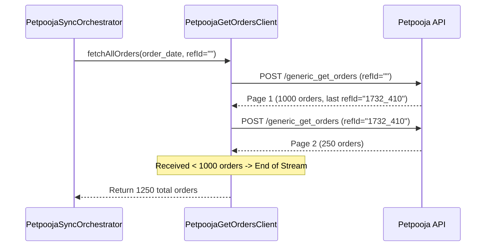
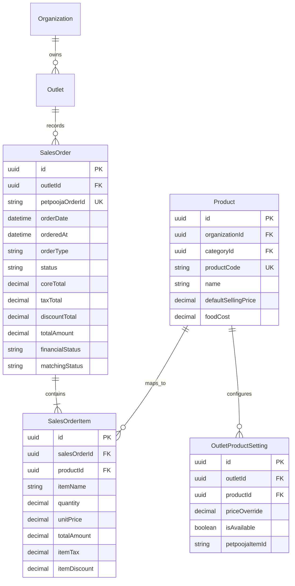

# Petpooja API, Database, and Data Mapping Technical Reference

**Document Version:** 1.1.0  
**Audit Date:** 2026-11-23  
**Verified Dataset:** Local PostgreSQL (`564` orders, `1,904` line items across `2026-11-19` to `2026-11-20`)  
**Scope:** Complete end-to-end technical documentation covering API configuration, request/response structures, order statuses, pagination, normalization pipeline, database schema and constraints, mapping dictionary, audited figures, financial reconciliation, data retrieval layer, and component development guide.

---

## 1. Overview and Architecture

The Gulmohar Analytics platform integrates with Petpooja Point of Sale (POS) via an automated pull synchronization architecture:
1. **Pull Model (Active Production Integration):** Scheduled batch synchronization via Petpooja's *Generic Get Orders API* to retrieve final operational-day sales data.
2. **Historical Exploration (Legacy Webhook Push - Removed):** During early technical evaluation, an inbound webhook receiver (`POST /api/webhooks/petpooja`) and a remote Supabase staging table (`petpooja_webhook_events`) were tested for raw push payloads. This has been completely removed in favor of direct, reliable batch pull synchronization directly into PostgreSQL via Prisma.

### Complete Data Flow Diagram

```
┌───────────────────────────────────────────────────────────────────────────────────┐
│                              PETPOOJA CLOUD PLATFORM                              │
│                                                                                   │
│                        Generic Get Orders API (Pull Model)                        │
└─────────────────────────────────────────┬─────────────────────────────────────────┘
                                          │ Daily Pull (order_date, restID)
                                          ▼
                             ┌─────────────────────────┐
                             │ PetpoojaGetOrdersClient │
                             │ (get-orders-client.ts)  │
                             └────────────┬────────────┘
                                          │ Raw Response Envelope
                                          ▼
                             ┌─────────────────────────┐
                             │ Pipeline Normalizer     │
                             │ (normalizer.ts)         │
                             └────────────┬────────────┘
                                          │ NormalizedSalesOrder
                                          ▼
                             ┌─────────────────────────┐
                             │ Outlet & Item Resolver  │
                             │ (resolver.ts)           │
                             └────────────┬────────────┘
                                          │ Resolved IDs (Outlet, Product)
                                          ▼
                             ┌─────────────────────────┐
                             │ Ingestion Service       │
                             │ (ingestion-service.ts)  │
                             └────────────┬────────────┘
                                          │ Transactional Upsert ($transaction)
                                          ▼
                             ┌─────────────────────────┐
                             │ PostgreSQL Database     │
                             │ (Prisma: SalesOrder &   │
                             │  SalesOrderItem)        │
                             └────────────┬────────────┘
                                          │ Prisma Queries (DATA_SOURCE=database)
                                          ▼
                             ┌─────────────────────────┐
                             │ Business Logic & UI     │
                             │ (Analytics & Dashboards)│
                             └─────────────────────────┘
```
                                                          └────────────┬────────────┘
                                                                       │ Database Loaders
                                                                       ▼
                                                          ┌─────────────────────────┐
                                                          │ Analytics Data Layer    │
                                                          │ src/lib/analytics/      │
                                                          └────────────┬────────────┘
                                                                       │ Clean Contracts
                                                                       ▼
                                                          ┌─────────────────────────┐
                                                          │ UI & Dashboard Charts   │
                                                          │ /dashboard/sales        │
                                                          └─────────────────────────┘
```

---

## 2. API Configuration

### 2.1 Generic Get Orders API (Pull Model)

| Parameter | Configuration / Specification |
| :--- | :--- |
| **Endpoint URL** | `https://api.petpooja.com/V1/thirdparty/generic_get_orders/` (Configurable via `PETPOOJA_GET_ORDERS_ENDPOINT`) |
| **HTTP Method** | `POST` |
| **Content-Type** | `application/json` |
| **Accept** | `application/json` |
| **Headers** | `Cookie: <PETPOOJA_API_COOKIE>` (Cloudflare session bypass cookie required) |
| **Authentication** | `app_key`, `app_secret`, `access_token` passed in JSON request body |
| **Date Format** | `YYYY-MM-DD` (`order_date`) |
| **Restaurant ID** | `restID` (Petpooja's alphanumeric outlet identifier, e.g. `20m...`) |
| **Pagination Type** | Cursor-based (`refId`) |
| **Pagination Limits**| Maximum 1,000 records per page |
| **Timeout Handling** | Default 15,000 ms via `AbortController` (`PetpoojaTimeoutError`) |
| **Error Handling** | Throws typed `PetpoojaHttpError` (HTTP != 200) or `PetpoojaApiError` (`success != "1"`) |
| **Retry Behavior** | Per-order transaction isolation during ingestion; client propagates request failure to sync orchestrator |

### 2.2 Historical Exploration: Global API (Push Webhook Model - Retired)

> [!NOTE]
> **Historical Reference Only:** During the initial Petpooja exploration phase, a push webhook receiver was created at `/api/webhooks/petpooja` to inspect incoming Petpooja payloads into a temporary Supabase staging table (`petpooja_webhook_events`). 
> This endpoint and Supabase dependency have been **completely removed**. The application architecture uses pull-based ingestion directly into PostgreSQL via Prisma, which provides full transactional integrity, consistent schema mapping, and end-of-day reconciliation.


---

## 3. Complete API Request Structure

### 3.1 Get Orders Request Payload
```json
{
  "app_key": "ENVIRONMENT_VARIABLE[PETPOOJA_APP_KEY]",
  "app_secret": "ENVIRONMENT_VARIABLE[PETPOOJA_APP_SECRET]",
  "access_token": "ENVIRONMENT_VARIABLE[PETPOOJA_ACCESS_TOKEN]",
  "restID": "ENVIRONMENT_VARIABLE[PETPOOJA_REST_ID]",
  "order_date": "2026-11-20",
  "refId": ""
}
```

#### Field Specifications:
- `app_key` (String, Required): Application developer key.
- `app_secret` (String, Required): Secret token assigned to the application.
- `access_token` (String, Required): OAuth/access token generated for the restaurant.
- `restID` (String, Required): Petpooja Restaurant ID identifying the physical outlet.
- `order_date` (String, Required): Operational business date (`YYYY-MM-DD`). In typical automated jobs, this is queried for $T-1$ after business hours close (around 4:00 AM IST).
- `refId` (String, Optional): Pagination cursor. Empty string `""` on initial page. On subsequent pages, pass the `refId` of the last order record from the previous page.

---

## 4. Complete API Response Structure

### Top-Level Envelope
```json
{
  "code": "200",
  "success": "1",
  "message": "Orders data fetched successfully",
  "order_json": [ /* Array of Order Entries */ ]
}
```

### Complete Field Dictionary (`order_json[]`)

#### 1. Restaurant Information (`Restaurant`)
| Field | Data Type | Description | Example | Nullable | Currently Stored |
|---|---|---|---|---|---|
| `restaurantid` | String | Internal Petpooja ID | `"12345"` | No | No |
| `restID` | String | Alphanumeric Restaurant Key | `"20m712b70p1"` | No | Mapped to `Outlet.petpoojaRestId` |
| `res_name` | String | Restaurant display name | `"Gulmohar Restaurant"` | No | No |
| `address` | String | Physical address | `"Beach Road, Calicut"` | Yes | No |
| `contact_information` | String | Phone / Mobile | `"9876543210"` | Yes | No |
| `restaurant_state` | String | State name/code | `"Kerala"` | Yes | No |

#### 2. Customer Information (`Customer`)
> **Privacy Architecture:**
> - **Main Application Database (`sales_orders`, `sales_order_items`):** Customer personal information (`name`, `phone`, `address`, `gst_no`) is **completely scrubbed** during normalization (`src/lib/petpooja/normalizer.ts`) and is **never** inserted into the database or exposed to analytics dashboards.
> - **Server Logs (`src/lib/petpooja/logger.ts`):** Application logs strictly mask phone numbers, names, and GST numbers before writing to console/stdout.
> - **Historical Webhook Staging (Retired):** The former legacy push webhook staging table (`petpooja_webhook_events` in Supabase) has been removed. All production ingestion goes through the pull normalizer where PII is omitted.
| Field | Data Type | Description | Example | Nullable | Normalized DB (`sales_orders`) |
|---|---|---|---|---|---|
| `name` | String | Customer full name | `"John Doe"` | Yes | **NO (Scrubbed)** |
| `phone` | String | Contact number | `"9876543210"` | Yes | **NO (Scrubbed)** |
| `address` | String | Delivery address | `"Flat 4B, Emerald Apts"`| Yes | **NO (Scrubbed)** |
| `gst_no` | String | Customer GSTIN | `"32AAAAA0000A1Z5"` | Yes | **NO (Scrubbed)** |
| `created_date`| String | Customer registration date | `"2026-01-10"` | Yes | **NO (Scrubbed)** |

#### 3. Order Header (`Order`)
| Field | Data Type | Description | Example | Nullable | Currently Stored |
|---|---|---|---|---|---|
| `orderID` | String | Primary Petpooja order identifier | `"41050212"` | No | `SalesOrder.petpoojaOrderId` |
| `refId` | String | Pagination cursor token | `"1732098526_41050212"` | No | Used during sync pagination |
| `order_date` | String | Operational calendar date (`YYYY-MM-DD`) | `"2026-11-20"` | No | `SalesOrder.orderDate` |
| `created_on` | String | Timestamp of order creation | `"2026-11-20 17:08:46"` | No | `SalesOrder.orderedAt` (IST parsed) |
| `status` | String | Order lifecycle state | `"Success"`, `"Cancelled"`| No | `SalesOrder.status` |
| `order_type` | String | Service type | `"Dine In"`, `"Delivery"` | No | `SalesOrder.orderType` |
| `sub_order_type` | String | Channel subtype | `"Zomato"`, `"Swiggy"` | Yes | No |
| `order_from` | String | Originating source | `"POS"`, `"Online"` | Yes | No |
| `core_total` | String/Num| Subtotal before taxes and discounts | `"190.00"` | No | `SalesOrder.coreTotal` |
| `tax_total` | String/Num| Total tax amount charged | `"9.50"` | No | `SalesOrder.taxTotal` |
| `discount_total`| String/Num| Total discount applied | `"0.00"` | No | `SalesOrder.discountTotal` |
| `total` | String/Num| Final bill total payable | `"200.00"` | No | `SalesOrder.totalAmount` |
| `round_off` | String | Round off adjustment | `"-0.50"` | Yes | No |
| `payment_type` | String | Primary payment mode | `"Cash"`, `"Card"` | Yes | Deferred (Placeholder) |
| `custom_payment_type` | String | Custom tender label | `"GooglePay"` | Yes | Deferred (Placeholder) |
| `table_no` | String | Table number for Dine In | `"T-12"` | Yes | No |
| `no_of_persons` | String | Guest covers count | `"4"` | Yes | No |
| `delivery_charges`| String | Delivery fee charged | `"30.00"` | Yes | No |
| `container_charges`| String| Packaging fee charged | `"15.00"` | Yes | No |
| `service_charge`| String | Service fee charged | `"0.00"` | Yes | No |
| `biller_name` | String | Name of billing staff | `"Staff 1"` | Yes | No |
| `cancel_order_description`| String | Reason for cancellation | `"Customer cancelled"` | Yes | No |
| `part_payment` | Array | Breakdown of split tenders | `[{ payment_type: "Cash", amount: "100" }]` | Yes | No |

#### 4. Order Line Items (`OrderItem[]`)
| Field | Data Type | Description | Example | Nullable | Currently Stored |
|---|---|---|---|---|---|
| `itemid` | String | Petpooja item ID | `"904812"` | No | Used for product resolution |
| `itemcode` | String | Petpooja SKU / code | `"DOS01"` | Yes | Used for product resolution |
| `name` | String | Name of the menu item | `"South Indian Meal"` | No | `SalesOrderItem.itemName` |
| `quantity` | String/Num| Units sold | `"2"` | No | `SalesOrderItem.quantity` |
| `price` | String/Num| Unit base price | `"190.00"` | No | `SalesOrderItem.unitPrice` |
| `total` | String/Num| Line total (`qty * price`) | `"380.00"` | No | `SalesOrderItem.totalAmount` |
| `total_tax` | String/Num| Tax attributed to line | `"19.00"` | Yes | `SalesOrderItem.itemTax` |
| `total_discount`| String/Num| Discount attributed to line | `"0.00"` | Yes | `SalesOrderItem.itemDiscount` |
| `categoryid` | String | POS category ID | `"CAT01"` | Yes | No |
| `categoryname` | String | Menu category name | `"Main Course"` | Yes | No (Item resolved via parent/mapping) |
| `specialnotes` | String | Kitchen instructions | `"Less spicy"` | Yes | No |
| `addon` | Array | Modifiers and add-ons | `[{ name: "Extra Sambhar" }]` | Yes | No |
| `item_tax_info`| Object | Item tax rates breakdown | `{ tax: { CGST: { value: 2.5 } } }` | Yes | No |

#### 5. Taxes Array (`Tax[]`)
| Field | Data Type | Description | Example | Nullable | Currently Stored |
|---|---|---|---|---|---|
| `title` | String | Tax identifier | `"CGST"`, `"SGST"` | No | Aggregated in `taxTotal` |
| `type` | String | Tax calculation mode | `"P"` (Percentage), `"F"` (Fixed) | No | Aggregated in `taxTotal` |
| `rate` | String | Tax percentage or rate | `"2.50"` | No | Aggregated in `taxTotal` |
| `amount` | String | Total tax currency amount | `"9.50"` | No | Aggregated in `taxTotal` |

#### 6. Discounts Array (`Discount[]`)
| Field | Data Type | Description | Example | Nullable | Currently Stored |
|---|---|---|---|---|---|
| `title` | String | Discount description | `"Flat 10% Off"`, `"Manager Disc"` | No | Aggregated in `discountTotal` |
| `type` | String | Discount mode | `"P"` (Percentage), `"F"` (Fixed) | No | Aggregated in `discountTotal` |
| `rate` | String | Discount rate | `"10.00"` | No | Aggregated in `discountTotal` |
| `amount` | String | Total discount amount | `"25.00"` | No | Aggregated in `discountTotal` |

---

## 5. Order Status & Business Semantics

The Petpooja integration recognizes three distinct order status values in production:

| Status Value | Meaning in Petpooja | Included in Net Sales? | Database Count (Audit) |
| :--- | :--- | :--- | :--- |
| **`Success`** | Bill completed, paid, and closed. | **Yes** | **547** |
| **`Complimentary`**| Billed as complimentary / 100% NC. | **No** (Separated from net revenue) | **15** |
| **`Cancelled`** | Billed and subsequently voided/cancelled. | **No** (Excluded from sales calculations) | **2** |

### Status Lifecycle & Ingestion Semantics:
- The Get Orders API returns the **latest final state** of orders for that operational day.
- If an order's status changes from `Success` to `Cancelled`, batch synchronization idempotently updates `SalesOrder.status = "Cancelled"`.

---

## 6. Pagination & Synchronization Logic

The sync pipeline (`src/lib/petpooja/sync.ts`) executes the following pagination sequence:



1. **Initial Call:** Requests `refId = ""`.
2. **Cursor Extraction:** Reads `refId` from the last record in `order_json`.
3. **Continuation Condition:** If `orders.length === 1000`, fetch next page with extracted `refId`.
4. **Termination Condition:** When `orders.length < 1000` or `maxPages` (default 50) is reached.
5. **Loop Safeguard:** Maintains `seenCursors: Set<string>`. If the same `refId` is returned twice, aborts with `PetpoojaPaginationError`.

---

## 7. Normalization & Transformation Pipeline

### Key Transformation Rules

| Petpooja Field | Normalization & Business Logic | Target Field |
| :--- | :--- | :--- |
| `Order.orderID` | Converted to string, trimmed. | `SalesOrder.petpoojaOrderId` |
| `Order.created_on` | Parsed as IST (`Asia/Kolkata`) `YYYY-MM-DD HH:mm:ss` into UTC `Date`. | `SalesOrder.orderedAt` |
| `Order.order_date` | Stored as ISO `Date` representing `YYYY-MM-DD 00:00:00Z`. | `SalesOrder.orderDate` |
| `Order.status` | Sanitized to `"Success"`, `"Cancelled"`, or `"Complimentary"`. | `SalesOrder.status` |
| `Order.core_total` | Parsed to `Prisma.Decimal` (Gross menu total). | `SalesOrder.coreTotal` |
| `Order.tax_total` | Parsed to `Prisma.Decimal`. | `SalesOrder.taxTotal` |
| `Order.discount_total`| Parsed to `Prisma.Decimal`. | `SalesOrder.discountTotal` |
| `Order.total` | Parsed to `Prisma.Decimal` (Final bill amount). | `SalesOrder.totalAmount` |
| `OrderItem.name` | Preserved as-is (e.g., `"South Indian Meal [D]"`). | `SalesOrderItem.itemName` |
| `OrderItem.price` | Parsed to `Prisma.Decimal`. | `SalesOrderItem.unitPrice` |
| `OrderItem.quantity` | Parsed to `Prisma.Decimal`. | `SalesOrderItem.quantity` |
| `OrderItem.total` | Parsed to `Prisma.Decimal`. | `SalesOrderItem.totalAmount` |

---

## 8. Database Schema & Architecture

### Relevant Database Tables



### Complete Prisma Definitions

```prisma
model SalesOrder {
  id              String   @id @default(dbgenerated("gen_random_uuid()")) @db.Uuid
  outletId        String   @map("outlet_id") @db.Uuid
  petpoojaOrderId String   @map("petpooja_order_id")
  orderDate       DateTime @map("order_date") @db.Date
  orderedAt       DateTime @map("ordered_at") @db.Timestamptz
  orderType       String   @map("order_type") // Dine In, Delivery
  status          String   @default("Success") // "Success", "Cancelled", "Complimentary"
  coreTotal       Decimal? @map("core_total") @db.Decimal(12, 2)
  taxTotal        Decimal? @map("tax_total") @db.Decimal(12, 2)
  discountTotal   Decimal? @map("discount_total") @db.Decimal(12, 2)
  totalAmount     Decimal? @map("total_amount") @db.Decimal(12, 2)
  financialStatus String   @default("pending") @map("financial_status")
  matchingStatus  String   @default("unmatched") @map("matching_status")
  createdAt       DateTime @default(now()) @map("created_at") @db.Timestamptz

  outlet Outlet           @relation(fields: [outletId], references: [id], onDelete: Restrict)
  items  SalesOrderItem[]

  @@unique([outletId, petpoojaOrderId])
  @@index([outletId, orderDate])
  @@map("sales_orders")
}

model SalesOrderItem {
  id           String   @id @default(dbgenerated("gen_random_uuid()")) @db.Uuid
  salesOrderId String   @map("sales_order_id") @db.Uuid
  productId    String?  @map("product_id") @db.Uuid // Nullable if unmatched to master
  itemName     String   @map("item_name")
  quantity     Decimal  @db.Decimal(10, 3)
  unitPrice    Decimal  @map("unit_price") @db.Decimal(10, 2)
  totalAmount  Decimal  @map("total_amount") @db.Decimal(12, 2)
  itemTax      Decimal? @map("item_tax") @db.Decimal(10, 2)
  itemDiscount Decimal? @map("item_discount") @db.Decimal(10, 2)

  salesOrder SalesOrder @relation(fields: [salesOrderId], references: [id], onDelete: Cascade)
  product    Product?   @relation(fields: [productId], references: [id], onDelete: SetNull)

  @@index([salesOrderId])
  @@index([productId])
  @@map("sales_order_items")
}

model OutletProductSetting {
  id               String   @id @default(dbgenerated("gen_random_uuid()")) @db.Uuid
  outletId         String   @map("outlet_id") @db.Uuid
  productId        String   @map("product_id") @db.Uuid
  priceOverride    Decimal? @map("price_override") @db.Decimal(10, 2)
  isAvailable      Boolean  @default(true) @map("is_available")
  petpoojaItemId   String?  @map("petpooja_item_id")
  updatedAt        DateTime @updatedAt @map("updated_at") @db.Timestamptz

  outlet  Outlet  @relation(fields: [outletId], references: [id], onDelete: Restrict)
  product Product @relation(fields: [productId], references: [id], onDelete: Cascade)

  @@unique([outletId, productId])
  @@index([outletId, petpoojaItemId])
  @@map("outlet_product_settings")
}
```

### Unmapped Products Handling
- If a line item does not match any internal `Product`, `SalesOrderItem.productId` is set to `null`.
- The item name is always preserved in `SalesOrderItem.itemName`.
- **Analytics queries group directly on `itemName`** rather than `productId` to ensure 100% of sales data is included in rankings.

---

## 9. Petpooja-to-Database Mapping Reference

| Petpooja Field | API Location | Database Model | Database Field | Transformation | Status |
| :--- | :--- | :--- | :--- | :--- | :--- |
| `orderID` | `Order.orderID` | `SalesOrder` | `petpoojaOrderId` | String converted, trimmed | Stored directly |
| `order_date` | `Order.order_date` | `SalesOrder` | `orderDate` | Converted to ISO Date (`YYYY-MM-DD`) | Stored after transformation |
| `created_on` | `Order.created_on` | `SalesOrder` | `orderedAt` | Parsed from IST to UTC Timestamptz | Stored after transformation |
| `order_type` | `Order.order_type` | `SalesOrder` | `orderType` | Standardized string | Stored directly |
| `status` | `Order.status` | `SalesOrder` | `status` | Sanitized to Success/Cancelled/Comp | Stored directly |
| `core_total` | `Order.core_total` | `SalesOrder` | `coreTotal` | Converted to `Prisma.Decimal` | Stored directly |
| `tax_total` | `Order.tax_total` | `SalesOrder` | `taxTotal` | Converted to `Prisma.Decimal` | Stored directly |
| `discount_total`| `Order.discount_total`| `SalesOrder` | `discountTotal`| Converted to `Prisma.Decimal` | Stored directly |
| `total` | `Order.total` | `SalesOrder` | `totalAmount` | Converted to `Prisma.Decimal` | Stored directly |
| `restID` | `Restaurant.restID` | `SalesOrder` | `outletId` | Resolved via `Outlet.petpoojaRestId` | Used only during processing |
| `name` | `OrderItem.name` | `SalesOrderItem` | `itemName` | String preserved as-is | Stored directly |
| `quantity` | `OrderItem.quantity` | `SalesOrderItem` | `quantity` | Converted to `Prisma.Decimal` | Stored directly |
| `price` | `OrderItem.price` | `SalesOrderItem` | `unitPrice` | Converted to `Prisma.Decimal` | Stored directly |
| `total` | `OrderItem.total` | `SalesOrderItem` | `totalAmount` | Converted to `Prisma.Decimal` | Stored directly |
| `total_tax` | `OrderItem.total_tax`| `SalesOrderItem` | `itemTax` | Converted to `Prisma.Decimal` | Stored directly |
| `total_discount`| `OrderItem.total_discount`| `SalesOrderItem` | `itemDiscount` | Converted to `Prisma.Decimal` | Stored directly |
| `itemid` | `OrderItem.itemid` | `SalesOrderItem` | `productId` | Resolved via `OutletProductSetting` | Used during processing |
| `payment_type` | `Order.payment_type` | None | None | Not persisted in table | Not yet supported |
| `cancel_order_description`| `Order.cancel_order_description`| None | None | Not persisted in table | Not yet supported |
| `Customer.*` | `Customer.*` | None | None | Scrubbed during normalization; never persisted | **Scrubbed from Normalized DB** |

---

## 10. Actual Local Database Audit Results

Snapshot audited on **2026-11-23**:

### Order Counts by Status
- **Success:** `547` orders
- **Complimentary:** `15` orders
- **Cancelled:** `2` orders
- **Total Orders:** `564` orders

### Order Counts by Type
- **Dine In:** `426` orders (409 Success, 15 Complimentary, 2 Cancelled)
- **Delivery:** `138` orders (138 Success)

### Line Item Statistics
- **Total Line Items:** `1,904`
- **Distinct Item Names:** `311`
- **Mapped Items:** `0` (Items currently unmapped; analytics query by `itemName`)
- **Unmapped Items:** `1,904`

### Financial Totals Grouped by Status
| Status | Orders | Core Total (₹) | Tax Total (₹) | Discount Total (₹) | Total Amount (₹) |
| :--- | :--- | :--- | :--- | :--- | :--- |
| **Success** | 547 | ₹3,60,470.00 | ₹14,367.70 | ₹6,499.29 | **₹3,68,403.00** |
| **Complimentary** | 15 | ₹7,495.00 | ₹374.78 | ₹0.00 | **₹7,871.00** |
| **Cancelled** | 2 | ₹495.00 | ₹11.50 | ₹0.00 | **₹507.00** |

### Sanitized Sample Records from Local Database

#### 1. Successful Order (`petpoojaOrderId = 59094`)
```json
{
  "id": "3877ef91-0c39-4cf1-a8ed-73a40573d388",
  "outletId": "4c78ce87-79cf-4f0d-817e-23e728db9bf8",
  "petpoojaOrderId": "59094",
  "orderDate": "2026-11-20T00:00:00.000Z",
  "orderedAt": "2026-11-20T17:08:46.000Z",
  "orderType": "Dine In",
  "status": "Success",
  "coreTotal": "4389.00",
  "taxTotal": "219.44",
  "discountTotal": "0.00",
  "totalAmount": "4608.00",
  "financialStatus": "reconciled",
  "items": [
    {
      "itemName": "Mint Lime Juice",
      "quantity": "1",
      "unitPrice": "80.00",
      "totalAmount": "80.00",
      "itemTax": "4.00",
      "itemDiscount": "0.00"
    },
    {
      "itemName": "Icecream Scoop-Chocolate",
      "quantity": "2",
      "unitPrice": "120.00",
      "totalAmount": "240.00",
      "itemTax": "12.00",
      "itemDiscount": "0.00"
    }
  ]
}
```

#### 2. Cancelled Order (`petpoojaOrderId = 59052`)
```json
{
  "id": "a3ff24d5-29a8-41f5-91ab-77414babc390",
  "outletId": "4c78ce87-79cf-4f0d-817e-23e728db9bf8",
  "petpoojaOrderId": "59052",
  "orderDate": "2026-11-20T00:00:00.000Z",
  "orderedAt": "2026-11-20T15:48:15.000Z",
  "orderType": "Dine In",
  "status": "Cancelled",
  "coreTotal": "230.00",
  "taxTotal": "11.50",
  "discountTotal": "0.00",
  "totalAmount": "242.00",
  "items": [
    {
      "itemName": "Onion & Tomato Uttapam",
      "quantity": "1",
      "unitPrice": "140.00",
      "totalAmount": "140.00"
    }
  ]
}
```

#### 3. Complimentary Order (`petpoojaOrderId = C1274`)
```json
{
  "id": "98eae72e-1c37-4b1e-b127-dd3da96c12f6",
  "outletId": "4c78ce87-79cf-4f0d-817e-23e728db9bf8",
  "petpoojaOrderId": "C1274",
  "orderDate": "2026-11-20T00:00:00.000Z",
  "orderedAt": "2026-11-20T16:06:43.000Z",
  "orderType": "Dine In",
  "status": "Complimentary",
  "coreTotal": "160.00",
  "taxTotal": "8.00",
  "discountTotal": "0.00",
  "totalAmount": "168.00",
  "items": [
    {
      "itemName": "Paneer Mango Curry",
      "quantity": "0.5",
      "unitPrice": "320.00",
      "totalAmount": "160.00"
    }
  ]
}
```

---

## 11. Financial Field Definitions & Reconciliation

### Equation of an Order
Through direct database verification of the 547 successful orders, the relationship between order totals is:

$$\text{totalAmount} = \text{coreTotal} - \text{discountTotal} + \text{taxTotal} + \text{roundOff}$$

### Definitions:
1. **Gross Menu Sales (`coreTotal`):** Sum of line item base prices before discounts and taxes. Equals $\sum (\text{item.quantity} \times \text{item.unitPrice})$.
2. **Net Sales (Dashboard Revenue Metric):** Total revenue earned by the restaurant after discounts. In Petpooja, `totalAmount` reflects the total collection.
3. **Total Tax (`taxTotal`):** GST (CGST + SGST) charged on the order.
4. **Discounts (`discountTotal`):** Promo or promotional vouchers deducted from gross sales.
5. **Complimentary & Cancelled Orders:** Both maintain monetary figures in Petpooja payload, but are **excluded** from Net Sales calculations to prevent false revenue inflation.

---

## 12. Existing Data Retrieval & Analytics Layer

All dashboard queries pass through `src/lib/analytics/sales.ts` and `src/lib/data/sales.ts`:

| Requirement | Function | Target Model | Scope Applied |
| :--- | :--- | :--- | :--- |
| **Headline KPI Summary** | `getSalesSummary(range)` | `SalesOrder` | Status = 'Success', Range |
| **Trend by Day/Week/Month** | `getSalesTrend(range, gran)` | `SalesOrder` | Status = 'Success', IST Day Buckets |
| **Orders Trend** | `getOrdersTrend(range, gran)` | `SalesOrder` | Status = 'Success', IST Day Buckets |
| **Hourly Sales** | `getHourlySales(range)` | `SalesOrder` | Status = 'Success', 0–23 IST Hours |
| **Order Type Share** | `getSalesByOrderType(range)` | `SalesOrder` | Status = 'Success', Group by `orderType` |
| **Top Selling Items** | `getItemSalesRanking(range)` | `SalesOrderItem`| Group by `itemName`, Sum Qty & Revenue |

---

## 13. Component Development Reference

When developing any new component using Petpooja sales data:

### Standard Query Template
```typescript
import { getSalesInRange, getItemSalesRanking } from "@/lib/analytics";

// 1. Always enforce tenant and date scope
const sales = await getSalesInRange(range, {
  organizationId: user.organizationId,
  outletId: selectedOutletId,
});

// 2. Successful orders are pre-filtered in getSalesInRange
// Net revenue is calculated as sale.net_amount
const totalRevenue = sales.reduce((sum, s) => sum + (s.net_amount ?? 0), 0);
```

### Component Guidelines:
1. **Never hardcode status:** Filter on `status = "Success"` for financial metrics.
2. **Group by `itemName`:** Do not group by `productId` because unmapped items have `productId = null`.
3. **Use IST formatting:** Convert timestamps using `Asia/Kolkata` timezone.

---

## 14. Data Gaps and Future Recommendations

| Data Gap | Available in Petpooja API? | Stored in Database? | Action Required for Analytics |
| :--- | :--- | :--- | :--- |
| **Payment Method (Cash/UPI/Card)** | Yes (`payment_type`, `part_payment`) | No (Deferred placeholder) | Add `paymentType` column to `SalesOrder` schema |
| **Cancellation Reasons** | Yes (`cancel_order_description`) | No | Add `cancellationReason` to `SalesOrder` schema |
| **Online Aggregator (Zomato/Swiggy)**| Yes (`order_from`, `online_order_id`)| No | Add `channel` and `channelOrderId` columns |
| **Table & Covers** | Yes (`table_no`, `no_of_persons`) | No | Add `tableNumber` and `coversCount` columns |
| **Category Mapping** | Yes (`categoryname`) | No | Map line items to internal `Category` or store raw string |
