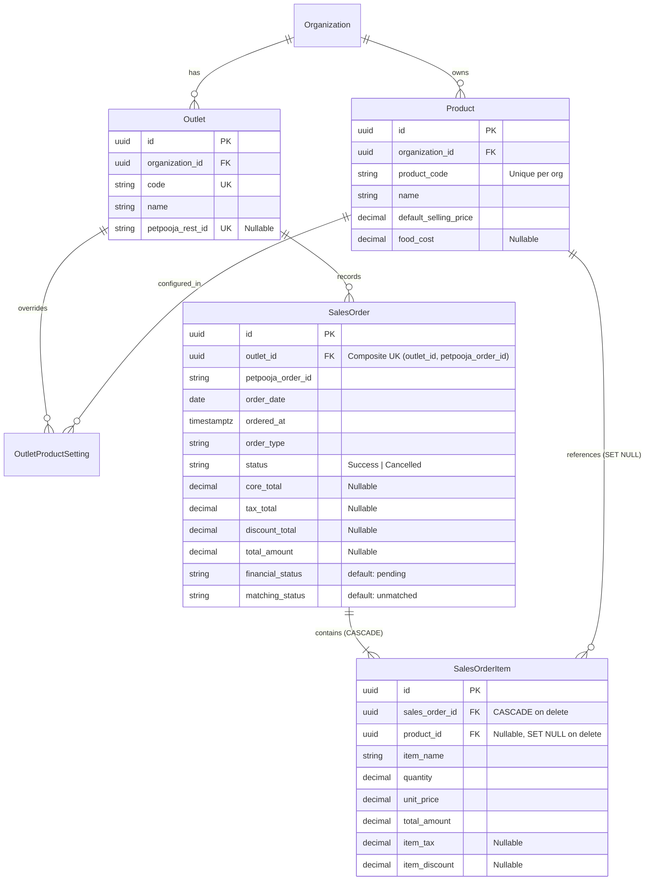
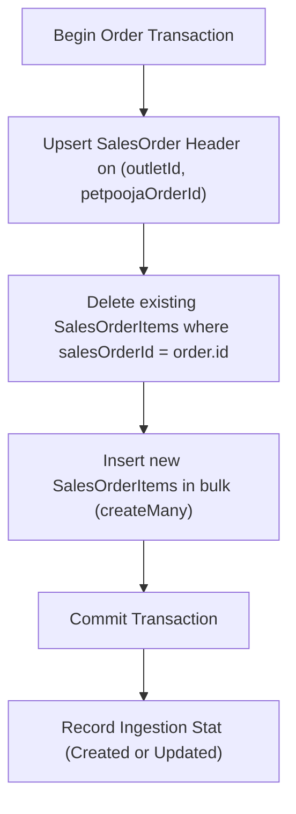

# Petpooja PostgreSQL Ingestion Readiness Audit (Stage 3A)

> **Document Classification:** Database Architecture & Ingestion Design Audit  
> **Status:** Stage 3A Read-Only Technical Audit  
> **Target Schema:** PostgreSQL (`prisma/schema.prisma`), Prisma Models, Existing Analytics Data Loaders, and Petpooja Normalization Output  
> **Scope:** Audit existing relational models, database constraints, sales loaders, reporting dependencies, outlet mapping, product mapping, and transactional upsert strategies. No database modifications or API calls performed.

---

## 1. Executive Summary

Stages 1 and 2 established:
1. **Production Get Orders API Client:** Robust POST fetching with authentication cookies, 1,000-record threshold pagination, cursor continuation, and loop/timeout safeguards.
2. **Deterministic Response Normalizer:** Conversion of nested Petpooja payload into clean, PII-free `NormalizedSalesOrder` and `NormalizedSalesOrderItem` objects with exact `Prisma.Decimal` arithmetic, ISO/IST timestamp parsing, and explicit validation issue tracking.

**Stage 3A audits the database readiness for ingesting these normalized objects into PostgreSQL.**

### Key Findings
1. **Outlet Mapping Requirement:** `outlets.petpooja_rest_id` is a unique column (`@unique`), but seed data currently leaves it `null`. To ingest orders for `restID = "9780nusx"`, the designated outlet (`KOZ-001`) must have `petpoojaRestId = "9780nusx"`.
2. **Product Code Scope:** In `prisma/schema.prisma`, product codes are **scoped to organizations**, NOT globally unique:
   ```prisma
   @@unique([organizationId, productCode])
   ```
   Because an outlet belongs to an organization, an item's Petpooja code can be resolved to a `Product` by querying `(organizationId, productCode)` or via `OutletProductSetting.petpoojaItemId`.
3. **Foreign Key Protection & Nullability:**
   - In `SalesOrderItem`, `productId` is **nullable** (`String? @db.Uuid`) with `onDelete: SetNull`.
   - **Crucial Architectural Asset:** An unmapped menu item (e.g. newly introduced on POS or a seasonal special) can be ingested safely with `productId = null` while preserving its exact Petpooja name, unit price, quantity, tax, discount, and line total. Unmapped items do not block the order or the rest of the batch.
4. **Order Update / Reconciliation Integrity:**
   - `SalesOrder` has a composite unique constraint: `@@unique([outletId, petpoojaOrderId])`.
   - `SalesOrderItem` relates to `SalesOrder` with `onDelete: Cascade`.
   - Re-importing or updating orders (e.g. night-time T-1 pull reconciling against intraday webhooks) can safely replace or update line items without creating duplicate rows or orphaned children.
5. **No Schema Changes Required for Phase 1 Ingestion:**
   - The existing Prisma schema for `SalesOrder` and `SalesOrderItem` already matches the normalized domain requirements. No table alteration or migration is needed for Phase 1.

---

## 2. Relational Schema & Database Constraints

### 2.1 Model Relationships Diagram



### 2.2 Detailed Constraint Matrix

| Model | Column / Constraint | Type & Attributes | Existing Behavior & Ingestion Safeguards |
| :--- | :--- | :--- | :--- |
| `Outlet` | `id` | `UUID @id @default(gen_random_uuid())` | Primary key. |
| `Outlet` | `petpoojaRestId` | `String? @unique @map("petpooja_rest_id")` | **Unique index.** Resolves `Restaurant.restID` to an internal outlet UUID. Disallows two outlets claiming the same POS merchant ID. |
| `Product` | `[organizationId, productCode]` | `@@unique([organizationId, productCode])` | Scoped product code. Allows multi-org isolation while maintaining strict uniqueness within an organization. |
| `SalesOrder` | `[outletId, petpoojaOrderId]` | `@@unique([outletId, petpoojaOrderId])` | **Natural upsert key.** Prevents duplicate orders per outlet across webhook pushes and scheduled pulls. |
| `SalesOrder` | `orderDate` | `DateTime @db.Date` | PostgreSQL date type. Normalized strictly as `YYYY-MM-DD`. |
| `SalesOrder` | `orderedAt` | `DateTime @db.Timestamptz` | Exact timestamp with timezone. Normalizer parses Asia/Kolkata (+05:30) and persists UTC instant. |
| `SalesOrder` | `financials` | `Decimal(12, 2) Nullable` | `coreTotal`, `taxTotal`, `discountTotal`, `totalAmount` are all nullable. Missing figures remain `null`. |
| `SalesOrderItem` | `salesOrderId` | `UUID FK -> SalesOrder.id` | Foreign key with `onDelete: Cascade`. |
| `SalesOrderItem` | `productId` | `UUID? FK -> Product.id` | **Nullable FK** with `onDelete: SetNull`. Allows ingestion of unmapped items without breaking data integrity. |
| `SalesOrderItem` | `quantity` | `Decimal(10, 3)` | High-precision quantity (supports fractional weights e.g. `1.500 kg`). |
| `SalesOrderItem` | `unitPrice` | `Decimal(10, 2)` | Exact price per unit. |
| `SalesOrderItem` | `totalAmount` | `Decimal(12, 2)` | Exact line gross total. |

---

## 3. Existing Sales Data Access & Reporting Dependencies

### 3.1 `getSales()` in `src/lib/data/sales.ts`
- **Filter Applied:**
  ```typescript
  where: {
    status: "Success",
    outletId: options?.outletId,
    orderDate: { gte: startDate, lte: endDate }
  }
  ```
- **Business Rule:** Only orders with `status: "Success"` are returned. Cancelled orders stored in `SalesOrder` are automatically excluded from revenue analytics, order counts, and averages.
- **Financial Mapping:**
  - `gross_amount`: `Number(order.coreTotal)` (or `null` if null).
  - `discount`: `Number(order.discountTotal)` (or `null` if null).
  - `net_amount`: `Number(order.totalAmount)` (or computed from `gross - discount` only if both are known, preserving unknown values per Task 9 financial integrity rules).

### 3.2 `getSaleItems()` in `src/lib/data/sale-items.ts`
- **Join Filter:**
  ```typescript
  where: {
    salesOrder: {
      status: "Success",
      outletId: options?.outletId,
      orderDate: { gte: ... }
    }
  }
  ```
- **Product Resolution:**
  ```typescript
  const productId = item.product?.productCode || item.productId || "";
  ```
  If `item.productId` is null (unmapped), the loader falls back to empty string `""` rather than inventing false associations.

### 3.3 Analytics & Dashboard Impact
- **Executive Dashboard (`/dashboard`):** Aggregates net sales, gross sales, order volume, and average order value (AOV) directly from `getSales()`.
- **Product Profitability (`src/lib/analytics/profitability.ts`):** Groups line items by `productId`. Items with `productId = null` are classified as unmapped and excluded from product margin calculations without crashing the reports.
- **Reports & Operational Contribution (`src/lib/analytics/contribution.ts`):** Relies on known net sales minus food costs and operational expenses. Ingesting clean sales orders with proper `status` and `orderDate` immediately integrates into the verified dashboard pages.

---

## 4. Outlet and Product Mapping Strategy

### 4.1 Outlet Mapping Strategy
- **Lookup Method:**
  ```typescript
  const outlet = await prisma.outlet.findUnique({
    where: { petpoojaRestId: normalizedOrder.petpoojaRestId },
    select: { id: true, organizationId: true, name: true }
  });
  ```
- **Handling Unmapped / Missing Outlet:**
  - If no outlet has `petpoojaRestId === order.petpoojaRestId`, the ingestion job **must not crash** and **must not guess** an outlet.
  - The order must be reported with a structured error (`"OUTLET_UNMAPPED: No outlet found with petpoojaRestId '${order.petpoojaRestId}'"`).
  - The job records the failure in the sync log and skips the order.

### 4.2 Product Mapping Strategy
- **Two-Tier Matching Hierarchy:**
  1. **Tier 1 (Outlet Override Mapping via `OutletProductSetting`):**
     Check if the specific outlet has an explicit mapping:
     ```typescript
     outletProductSettings.find(s => s.outletId === outlet.id && s.petpoojaItemId === item.petpoojaItemId)
     ```
  2. **Tier 2 (Organization Product Master Code Matching):**
     Match `item.petpoojaItemCode` against `Product.productCode` within the outlet's organization:
     ```typescript
     products.find(p => p.organizationId === outlet.organizationId && p.productCode === item.petpoojaItemCode)
     ```
  3. **Tier 3 (Unmapped Fallback):**
     If neither Tier 1 nor Tier 2 matches:
     - Set `productId = null`.
     - Set `matchingStatus = "unmatched"` on the sales order.
     - Save item name, price, quantity, and total in `SalesOrderItem`.
     - Log an informational warning in the ingestion report (`"ITEM_UNMAPPED: Item code '${item.petpoojaItemCode}' ('${item.itemName}') not mapped in master"`).

---

## 5. Transaction & Upsert Strategy for Ingestion

### 5.1 The Idempotency & Repeat Ingestion Challenge
When the overnight pull runs, or when an operator triggers a manual synchronization for a date:
1. Some orders may already exist from earlier webhook pushes.
2. Orders may have been cancelled or modified after initial creation.
3. Simply running `create` causes unique constraint violations on `(outletId, petpoojaOrderId)`.
4. Updating orders without managing children can cause duplicated `SalesOrderItem` records.

### 5.2 Recommended Atomic Upsert Algorithm
For each normalized order, perform the update within an explicit database transaction (`prisma.$transaction`):



#### Step 1: Upsert `SalesOrder` Header
```typescript
const orderRecord = await tx.salesOrder.upsert({
  where: {
    outletId_petpoojaOrderId: {
      outletId: outlet.id,
      petpoojaOrderId: order.petpoojaOrderId,
    },
  },
  create: {
    outletId: outlet.id,
    petpoojaOrderId: order.petpoojaOrderId,
    orderDate: new Date(`${order.orderDate}T00:00:00.000Z`),
    orderedAt: order.orderedAt,
    orderType: order.orderType,
    status: order.status,
    coreTotal: order.coreTotal,
    taxTotal: order.taxTotal,
    discountTotal: order.discountTotal,
    totalAmount: order.totalAmount,
    financialStatus: "reconciled",
    matchingStatus: hasUnmappedItems ? "partially_matched" : "matched",
  },
  update: {
    orderDate: new Date(`${order.orderDate}T00:00:00.000Z`),
    orderedAt: order.orderedAt,
    orderType: order.orderType,
    status: order.status, // Automatically updates "Success" -> "Cancelled" if voided
    coreTotal: order.coreTotal,
    taxTotal: order.taxTotal,
    discountTotal: order.discountTotal,
    totalAmount: order.totalAmount,
    financialStatus: "reconciled",
    matchingStatus: hasUnmappedItems ? "partially_matched" : "matched",
  },
});
```

#### Step 2: Atomic Item Replacement
Because line items on POS tickets can be voided, added, or changed:
```typescript
// 1. Delete previous line items for this specific order
await tx.salesOrderItem.deleteMany({
  where: { salesOrderId: orderRecord.id },
});

// 2. Insert refreshed line items
await tx.salesOrderItem.createMany({
  data: order.items.map((item) => ({
    salesOrderId: orderRecord.id,
    productId: resolvedProductIdMap.get(item.petpoojaItemCode) || null,
    itemName: item.itemName,
    quantity: item.quantity,
    unitPrice: item.unitPrice,
    totalAmount: item.totalAmount,
    itemTax: item.itemTax,
    itemDiscount: item.itemDiscount,
  })),
});
```

### 5.3 Batching and Performance Considerations
- A typical operational day has 500 to 1,500 orders (e.g. 507 orders on 2026-11-17 with ~2,000 line items).
- Executing individual order transactions sequentially or in chunks of 50-100 orders balances memory, prevents transaction timeout, and ensures failure of one corrupted order does not roll back the entire operational day.

---

## 6. Risks to Existing Reports & Mitigations

| Risk | Impact | Existing Code / Architectural Mitigation |
| :--- | :--- | :--- |
| **Cancelled Orders Distorting Revenue** | Revenue over-reported if cancelled orders are treated as sales. | **Mitigated:** `getSales()` and `getSaleItems()` strictly query `where: { status: "Success" }`. Cancelled orders are stored with `status: "Cancelled"` and automatically omitted from financial aggregates. |
| **Duplicate Line Items on Re-runs** | Sales quantities and item revenues double if a sync is rerun. | **Mitigated:** The transaction strategy explicitly deletes existing child line items before inserting fresh ones (`deleteMany` + `createMany`). |
| **Unknown Financials Rendered as Zero** | Violates Task 9 Financial Integrity Rules (silently turning unknown costs/discounts to zero). | **Mitigated:** `SalesOrder.coreTotal`, `taxTotal`, `discountTotal`, and `totalAmount` allow `null`. `parseDecimalValue` preserves `null` for missing figures. `getSales()` maps `null` through to the UI. |
| **Unmapped Products Crashing Margin Analytics** | Unmapped POS SKU causes product profitability to fail. | **Mitigated:** `SalesOrderItem.productId` is nullable. `getSaleItems()` returns `productId: ""` for unmapped items. Profitability loader filters or groups unmapped items without crashing. |
| **Date / Timezone Offset Shifts** | An order at 11:45 PM IST shifts to the wrong day in UTC. | **Mitigated:** `orderDate` is stored separately as a strict `@db.Date` reflecting the operational business day (`YYYY-MM-DD`), while `orderedAt` preserves the exact UTC instant. Analytics group by `orderDate`. |

---

## 7. Required Configuration Adjustments (No Schema Migration Needed)

The database schema in [prisma/schema.prisma](file:///d:/Dhanil/Git%20Repositeries/gulmohar-analytic-dashboard/prisma/schema.prisma) already has all necessary columns, constraints, and indexes.

The only operational configuration change needed in the database is **setting `petpoojaRestId` on the designated outlet**:
```sql
UPDATE outlets 
SET petpooja_rest_id = '9780nusx' 
WHERE code = 'KOZ-001' AND petpooja_rest_id IS NULL;
```
*(Or including `petpoojaRestId: "9780nusx"` in seed data for development/testing).*

---

## 8. Proposed Implementation Sequence for Stage 3B (Ingestion Service)

1. **Step 1: Product & Outlet Resolver Module (`src/lib/petpooja/resolver.ts`):**
   - Efficient cached lookups for `Outlet` by `petpoojaRestId`.
   - In-memory map builder for `Product` matching within an organization (by `productCode` and `OutletProductSetting.petpoojaItemId`).
2. **Step 2: Core Ingestion Service (`src/lib/petpooja/ingestion-service.ts`):**
   - Implements `ingestNormalizedOrder(order, tx)` and `ingestNormalizedBatch(batch, options)`.
   - Uses the transactional upsert and clean child replacement pattern.
   - Collects detailed ingestion metrics (orders created, orders updated, orders skipped, items mapped, items unmapped).
3. **Step 3: Integration Synchronization Runner (`src/lib/petpooja/sync.ts`):**
   - Connects Stage 1 (`PetpoojaGetOrdersClient`) $\to$ Stage 2 (`normalizer`) $\to$ Stage 3 (`ingestion-service`).
   - Accepts `targetDate: string` and `outletRestId?: string`.
4. **Step 4: Unit & Integration Verification Suite (`tests/petpooja-ingestion.test.ts`):**
   - Tests idempotent upserting, cancellation updates, unmapped product fallbacks, and multi-item orders using transactions with rollback or mock database fixtures.

