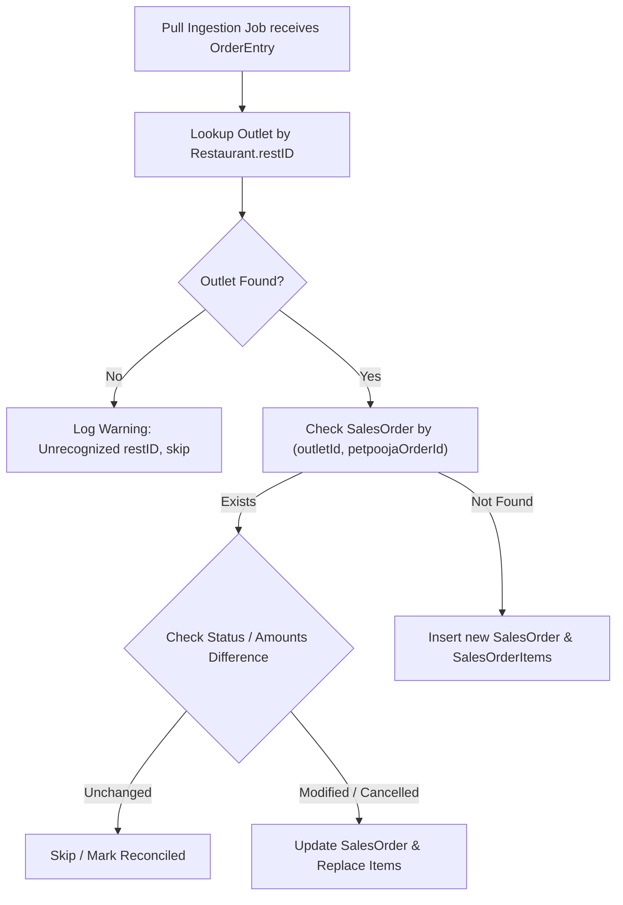

# Petpooja Get Orders API Response Schema Analysis & Field Mapping

> **Document Classification:** Technical Architecture & Schema Audit  
> **Target API:** Petpooja Generic Get Orders API (`POST https://api.petpooja.com/V1/thirdparty/generic_get_orders/`)  
> **Source Evidence:** Live sample dataset `tmp/petpooja-sample-2026-11-17.json` (507 orders returned for target date `2026-11-17`), `src/types/petpooja.ts`, `prisma/schema.prisma`, `src/lib/petpooja/validator.ts`, and `src/app/api/webhooks/petpooja/route.ts`.  
> **Methodology:** Strictly read-only static code and payload inspection. No database modifications or additional API requests performed.

---

## 1. Executive Summary & Verification Context

On **2026-11-18**, the production Get Orders endpoint was verified against merchant credentials for Gulmohar Restaurant (`restID = 9780nusx`). 
- **HTTP Status:** 200 OK (Latency: 1,608 ms)
- **Top-Level Success:** `"1"` (code: `"200"`)
- **Total Orders Returned:** 507 orders for operational date `2026-11-17`
- **Result Type:** Complete single-page payload (order count < 1,000 threshold)
- **PII Protection:** All customer phone numbers, GSTINs, addresses, and special notes were recursively redacted prior to local file persistence.

This document details the observed field inventory, data types, financial representations, pagination mechanics, mapping compatibility with the Prisma relational schema, unmapped payload fields, and duplicate detection strategies across push webhooks and pull API fetches.

---

## 2. Top-Level API Response Structure

The root response returned by the Petpooja Get Orders API is a JSON object with four primary keys:

```json
{
  "code": "200",
  "success": "1",
  "message": "",
  "order_json": [
    {
      "Restaurant": { ... },
      "Customer": { ... },
      "Order": { ... },
      "Tax": [ ... ],
      "Discount": [ ... ],
      "OrderItem": [ ... ]
    }
  ]
}
```

### Root Fields Specification

| Field | Observed Type | Documented Type | Nullable / Optional | Description |
| :--- | :--- | :--- | :--- | :--- |
| `code` | `string` | `string` | Non-null | HTTP-like status code string (e.g., `"200"`, `"400"`). |
| `success` | `string` | `string` | Non-null | API success flag: `"1"` indicates success, `"0"` indicates failure. |
| `message` | `string` | `string` | Optional / Empty | Informational or error message (empty string `""` on success). |
| `order_json` | `Array<OrderEntry>` | `Array` | Optional / Empty | Array of order objects. Omitted or empty when no records match. |

Each element inside `order_json` represents a single transaction envelope containing six sub-objects / arrays:
1. `Restaurant` (Object): Store identity and metadata.
2. `Customer` (Object): Buyer contact and billing details.
3. `Order` (Object): Transaction header, channel, settlement, and financial totals.
4. `Tax` (Array): Order-level tax breakdown components.
5. `Discount` (Array): Order-level discount promotions applied.
6. `OrderItem` (Array): Line-item records comprising menu items, modifiers, item taxes, and item discounts.

---

## 3. Order-Level Field Inventory (`Order` Object)

The `Order` object contains 32 distinct attributes in the verified payload:

| Field Name | Observed Type | Example Value | Nullable / Optional | Semantic Description |
| :--- | :--- | :--- | :--- | :--- |
| `orderID` | `string` | `"58322"` | Non-null | Sequential POS order/bill number within outlet. |
| `refId` | `string` | `"9919181663"` | Non-null | Petpooja global sequence cursor ID (vital for pagination). |
| `order_date` | `string` | `"2026-11-17"` | Non-null | Operational/accounting business date (`YYYY-MM-DD`). |
| `created_on` | `string` | `"2026-11-17 22:35:41"` | Non-null | POS clock timestamp when bill was generated (`YYYY-MM-DD HH:MM:SS`). |
| `order_type` | `string` | `"Dine In"`, `"Delivery"` | Non-null | Order service mode (`Dine In`, `Delivery`, `Pick Up`). |
| `sub_order_type` | `string` | `"Other"`, `"Delivery"` | Optional | POS sub-channel or aggregator variant. |
| `sub_order_type_id` | `string` | `"403958"`, `"252803"` | Optional | Internal Petpooja identifier for sub-order type. |
| `order_from` | `string` | `"POS"` | Non-null | Source system (e.g. `POS`, `Zomato`, `Swiggy`). |
| `status` | `string` | `"Success"` | Non-null | Final status of the transaction (`Success`, `Cancelled`). |
| `payment_type` | `string` | `"Cash"`, `"Other"` | Non-null | Primary payment bucket (`Cash`, `Card`, `Other`, `Part Payment`). |
| `custom_payment_type` | `string` | `""`, `"Google Pay"`, `"Swiggy"` | Optional | Tender detail when `payment_type` is `"Other"`. |
| `table_no` | `string` | `"C5"`, `"D5"`, `""` | Optional | Seating table code. Empty string for delivery/takeaway. |
| `no_of_persons` | `string` | `"2"`, `"0"` | Optional | Guest covers/pax count. Formatted as numeric string. |
| `core_total` | `string` | `"1032"`, `"655"` | Non-null | Subtotal before taxes, discounts, packaging (string representation). |
| `tax_total` | `string` | `"51.6"`, `"0"` | Non-null | Aggregate taxes billed to customer (string representation). |
| `discount_total` | `string` | `"0"`, `"140"` | Non-null | Total order discounts deducted (string representation). |
| `round_off` | `string` | `"0.40"`, `"-0.22"` | Non-null | Cash rounding difference to reach final total. |
| `total` | `string` | `"1084"`, `"515"` | Non-null | Net payable invoice amount collected from customer. |
| `delivery_charges` | `string` | `"0"` | Optional | Delivery fee collected. Formatted as numeric string. |
| `container_charges` | `string` | `"0"` | Optional | Packaging fee collected. Formatted as numeric string. |
| `service_charge` | `number` (integer) | `0` | Optional | Restaurant service charge. **Note: returned as integer `0`**. |
| `waivedOff` | `string` | `"0"` | Optional | Waived amount. |
| `tip` | `string` | `"0"` | Optional | Gratuity amount. |
| `advance_order` | `string` | `"No"` | Optional | Advance booking flag (`"Yes"` / `"No"`). |
| `part_payment` | `Array` | `[]` | Optional | Split payment breakdown array (empty when single tender). |
| `is_food_res` | `string` | `""` | Optional | Food restriction / tax categorization flag. |
| `online_order_id` | `string` | `""` | Optional | Aggregator order identifier (e.g. Zomato/Swiggy order #). |
| `cancel_order_description`| `string` | `""` | Optional | Reason recorded if order was cancelled. |
| `biller_name` | `string` | `"RAHUL"`, `"biller"` | Optional | Cashier/operator profile name on POS. |
| `fa_name` | `string` | `"RAHUL DAS"`, `""` | Optional | Floor Attendant / Waiter / Assignee name. |
| `group_ids` | `string` | `"167227"`, `"312556"` | Optional | Menu pricing group IDs active at order time. |
| `group_names` | `string` | `"Dine In New Menu"` | Optional | Menu pricing group display names. |

---

## 4. Line-Item Field Inventory (`OrderItem` Object)

The `OrderItem` array contains itemized rows billed on each ticket. Each object contains 21 distinct attributes:

| Field Name | Observed Type | Example Value | Nullable / Optional | Semantic Description |
| :--- | :--- | :--- | :--- | :--- |
| `itemid` | `string` | `"1318297226"` | Non-null | Unique Petpooja global master ID for the product item. |
| `itemcode` | `string` | `"110"`, `"170 [d]"` | Non-null | Outlet/Merchant SKU / short code configured on POS. |
| `name` | `string` | `"Butter Roti"`, `"Paneer Nirvana"` | Non-null | Menu item display title. |
| `categoryid` | `string` | `"11147700"` | Optional | Petpooja category master ID. |
| `categoryname` | `string` | `"Breads"`, `"Cold Beverages"` | Optional | Menu category title. |
| `price` | `string` | `"48"`, `"350"` | Non-null | Selling price per unit before discounts/tax (numeric string). |
| `quantity` | `string` | `"4"`, `"1"` | Non-null | Billed quantity (numeric string). |
| `total` | `string` | `"192"`, `"350"` | Non-null | Line gross total: `price * quantity` (numeric string). |
| `total_discount` | `number` (int/float) | `0`, `14`, `50.23` | Non-null | Item-level proportional discount share (**numeric type**). |
| `total_tax` | `number` (int/float) | `9.6`, `17.5`, `0` | Non-null | Item-level calculated tax amount (**numeric type**). |
| `tax_ids` | `string` | `"78753,78754"`, `"0"` | Optional | Comma-delimited list of applied tax component IDs. |
| `specialnotes` | `string` | `""` | Optional | Kitchen instructions / customization requests. |
| `addon` | `Array` | `[]` | Optional | Modifier items / add-ons array (toppings, variants). |
| `item_tax_info` | `object` | `{"tax": {...}, "total_tax_i": 9.6}` | Optional | Detailed tax distribution split (SGST, CGST, etc.). |
| `itemsapcode` | `string` | `""` | Optional | External ERP / SAP integration SKU reference. |
| `item_hsn_code` | `string` | `""` | Optional | Indian GST HSN/SAC classification code. |
| `is_upsell_combo` | `string` | `"0"` | Optional | Boolean flag `"1"` / `"0"` indicating combo promotion item. |
| `combo_discount` | `string` | `"0"` | Optional | Discount attributed to combo bundling. |
| `combo_parent_item_id` | `string` | `""` | Optional | Parent item reference if item is part of a combo meal. |
| `groupid` | `string` | `"167227"` | Optional | Menu pricing section group ID. |
| `groupname` | `string` | `"Dine In New Menu"` | Optional | Menu pricing section group name. |

---

## 5. Other Payload Sub-Objects

### 5.1 `Restaurant`
- `restaurantid`: `"57175"` (Petpooja internal chain ID)
- `restID`: `"9780nusx"` (Outlet external identifier, matches `outlets.petpooja_rest_id`)
- `res_name`: `"GULMOHAR RESTAURANT"`
- `restaurant_state`: `"Kerala"`
- `address`: Redacted string
- `contact_information`: Redacted string

### 5.2 `Customer`
- `name`: String (often empty `""` for walk-in POS Dine-In orders, or redacted name for delivery)
- `phone`: String (empty `""` or redacted)
- `address`: Redacted string
- `gst_no`: String (customer GSTIN for B2B tax invoices)
- `created_date`: Timestamp string (e.g. `"2021-10-21 15:23:35"`)

### 5.3 `Tax` (Order-Level Array)
Breakdown of taxes assessed on the order:
- `taxid`: `"78753"`
- `title`: `"SGST"`, `"CGST"`
- `type`: `"P"` (Percentage) or `"F"` (Fixed)
- `rate`: `"2.5"` (e.g. 2.5% SGST + 2.5% CGST = 5% GST total)
- `amount`: `"25.8"`
- `taxontaxids`: `""`

### 5.4 `Discount` (Order-Level Array)
Breakdown of overall discounts:
- `discountid`: `0`
- `title`: `"Special Discount"`
- `type`: `"F"` (Fixed) or `"P"` (Percentage)
- `rate`: `"0"`
- `amount`: `"140"`

---

## 6. Data Types, Formats, and Critical Inconsistencies

### 6.1 Type Mixed Representations (Strings vs Numbers)
A critical insight observed in the live payload is that **Petpooja mixes data types between the Order header and OrderItem**:
1. **Header Financials are Strings:**  
   `Order.core_total`, `Order.tax_total`, `Order.discount_total`, `Order.total`, and `Order.round_off` are serialized as **strings** (e.g. `"1032"`, `"51.6"`, `"0"`).
2. **Exception in Header:**  
   `Order.service_charge` was returned as a native **integer** (`0`), whereas all other charges were strings (`"0"`).
3. **Item Financials are Split:**  
   - `OrderItem.price`, `OrderItem.quantity`, `OrderItem.total` are **strings** (e.g. `"48"`, `"4"`, `"192"`).
   - `OrderItem.total_discount` and `OrderItem.total_tax` are native **numbers** (e.g. `0`, `9.6`, `50.23`).
4. **Prisma / Decimal Guard:**  
   Any ingestion parser must safely coerce these via `new Prisma.Decimal(String(val))` or `parseFloat(String(val))` rather than assuming uniform JSON numeric types.

### 6.2 Date and Timestamp Formats
- **`order_date`:** Strict ISO date format `YYYY-MM-DD` (e.g. `"2026-11-17"`). Represents the operational day the order was billed to. Matches PostgreSQL `@db.Date`.
- **`created_on`:** Local POS timestamp formatted as `YYYY-MM-DD HH:MM:SS` (e.g. `"2026-11-17 22:35:41"`).  
  *Important Note on Timezones:* Petpooja emits timestamps in Indian Standard Time (IST / `Asia/Kolkata`, UTC+05:30) without explicit timezone offsets. Ingestion must parse this as `+05:30` when mapping to PostgreSQL `@db.Timestamptz`.

### 6.3 Order Status Values
- **Observed:** `"Success"` (all 507 orders in the sample dataset were `"Success"`).
- **Documented:** `"Cancelled"` (orders cancelled or voided at POS).

---

## 7. Pagination Mechanics and Cursor Behavior

1. **Cursor Key:** `Order.refId` (e.g. `"9919181663"`).
2. **Initial Call:** Dispatched with `refId: ""` in the POST payload body.
3. **Batch Threshold:** Petpooja's Get Orders API pages in increments of **1,000 orders maximum**.
4. **Observed Behavior on 2026-11-17:**
   - 507 orders returned.
   - Because 507 < 1,000, this single response represents the entirety of orders for the day.
   - Pagination loop terminates immediately when `order_count < 1000`.
5. **Multi-Page Pagination Rule:**
   - If `order_count === 1000`, the next page must be requested using `refId = order_json[order_json.length - 1].Order.refId`.
   - The loop repeats until a response returns fewer than 1,000 orders or an empty `order_json`.

---

## 8. Field Mapping to Prisma Schema (`SalesOrder` & `SalesOrderItem`)

The application schema defines `SalesOrder` and `SalesOrderItem` in [prisma/schema.prisma](file:///d:/Dhanil/Git%20Repositeries/gulmohar-analytic-dashboard/prisma/schema.prisma#L335-L376).

### 8.1 Header Mapping: Petpooja `Order` $\to$ `SalesOrder`

| Petpooja Payload Field | Prisma `SalesOrder` Field | PostgreSQL Column | Type Conversion / Logic |
| :--- | :--- | :--- | :--- |
| `Restaurant.restID` | `outletId` | `outlet_id` (UUID) | Resolve via `Outlet.findUnique({ where: { petpoojaRestId } })`. |
| `Order.orderID` | `petpoojaOrderId` | `petpooja_order_id` (TEXT) | Direct string mapping. Unique with `outletId`. |
| `Order.order_date` | `orderDate` | `order_date` (DATE) | Parse `YYYY-MM-DD` as midnight UTC Date. |
| `Order.created_on` | `orderedAt` | `ordered_at` (TIMESTAMPTZ) | Parse as IST timestamp (`YYYY-MM-DDTHH:MM:SS+05:30`). |
| `Order.order_type` | `orderType` | `order_type` (TEXT) | Direct string (`"Dine In"`, `"Delivery"`, etc.). |
| `Order.status` | `status` | `status` (TEXT) | Direct string (`"Success"`, `"Cancelled"`). |
| `Order.core_total` | `coreTotal` | `core_total` (DECIMAL(12,2))| Convert string to `Decimal`. Null if absent/invalid. |
| `Order.tax_total` | `taxTotal` | `tax_total` (DECIMAL(12,2)) | Convert string to `Decimal`. |
| `Order.discount_total` | `discountTotal`| `discount_total` (DECIMAL(12,2))| Convert string to `Decimal`. |
| `Order.total` | `totalAmount` | `total_amount` (DECIMAL(12,2)) | Convert string to `Decimal`. |
| *(Internal system)* | `financialStatus`| `financial_status` | Default `"pending"` / `"reconciled"`. |
| *(Internal system)* | `matchingStatus` | `matching_status` | Default `"unmatched"` / `"matched"`. |

### 8.2 Line Item Mapping: Petpooja `OrderItem` $\to$ `SalesOrderItem`

| Petpooja Payload Field | Prisma `SalesOrderItem` Field | PostgreSQL Column | Type Conversion / Logic |
| :--- | :--- | :--- | :--- |
| *(Parent relation)* | `salesOrderId` | `sales_order_id` (UUID) | Foreign key to `SalesOrder.id`. |
| `OrderItem.itemcode` | `productId` | `product_id` (UUID) | Match against `Product.productCode` (scoped to Org). Nullable if unmatched. |
| `OrderItem.name` | `itemName` | `item_name` (TEXT) | Direct string copy from Petpooja item title. |
| `OrderItem.quantity` | `quantity` | `quantity` (DECIMAL(10,3))| Convert string `"4"` to Decimal `4.000`. |
| `OrderItem.price` | `unitPrice` | `unit_price` (DECIMAL(10,2))| Convert string `"48"` to Decimal `48.00`. |
| `OrderItem.total` | `totalAmount` | `total_amount` (DECIMAL(12,2))| Convert string `"192"` to Decimal `192.00`. |
| `OrderItem.total_tax` | `itemTax` | `item_tax` (DECIMAL(10,2)) | Convert number `9.6` to Decimal `9.60`. |
| `OrderItem.total_discount`| `itemDiscount` | `item_discount` (DECIMAL(10,2))| Convert number `0` to Decimal `0.00`. |

---

## 9. Unmapped Payload Fields & Storage Considerations

The Prisma `SalesOrder` and `SalesOrderItem` models are intentionally normalized for high-performance dashboard analytics. Consequently, several operational metadata fields present in Petpooja are not mapped to dedicated relational columns:

### 9.1 Unmapped Order Fields
1. **Settlement & Payment Details:** `payment_type` (`"Cash"`, `"Other"`), `custom_payment_type` (`"Google Pay"`, `"Swiggy"`), and `part_payment` breakdowns.
2. **Table & Staff Identifiers:** `table_no`, `no_of_persons`, `biller_name`, and `fa_name` (waiter/assignee).
3. **Rounding & Surcharges:** `round_off`, `delivery_charges`, `container_charges`, `service_charge`, `tip`, and `waivedOff`.
4. **Customer Data:** `Customer` object (name, phone, address, GSTIN). *(Note: Redacted or excluded from analytics to preserve privacy and minimize PII footprint)*.
5. **Menu Groups:** `group_ids`, `group_names`.

### 9.2 Unmapped Item Fields
1. **Addons & Modifiers:** `OrderItem.addon` array (e.g. extra toppings, preparation variants).
2. **Item Tax Detail Split:** `item_tax_info` (granular CGST vs SGST breakdown per item).
3. **Tax & Category Codes:** `tax_ids`, `categoryid`, `itemsapcode`, `item_hsn_code`.
4. **Combo Metadata:** `is_upsell_combo`, `combo_discount`, `combo_parent_item_id`.

> [!NOTE]
> In Phase 1 architecture, raw payloads are staged byte-for-byte in the Supabase staging table `public.petpooja_webhook_events`. Unmapped operational details remain fully retrievable from the staged JSON if needed for future tender audits or tax filing reports.

---

## 10. Duplicate Detection & Reconciliation Strategy Across Push and Pull

Gulmohar Analytics uses a hybrid ingestion pipeline:
1. **Push Webhook (`/api/webhooks/petpooja`):** Delivers near real-time orders during the business day into `petpooja_webhook_events`.
2. **Pull Ingestion (`PetpoojaGetOrdersClient`):** Runs overnight (T-1) to fetch authoritative day-end sales orders directly from Petpooja.

### 10.1 Natural Unique Identifier
- **Composite Key:** `(outlet_id, petpooja_order_id)`
- Prisma model enforces:
  ```prisma
  @@unique([outletId, petpoojaOrderId])
  ```
- In Petpooja, `Order.orderID` is unique per restaurant outlet (`restID`).

### 10.2 Recommended Upsert / Idempotency Algorithm

When processing historical pull records against existing live webhook records:



1. **Idempotent Upsert (`upsert`):**
   - Use `prisma.salesOrder.upsert` keyed on `outletId_petpoojaOrderId`.
   - If an order was already inserted by the real-time webhook, the pull sync updates the record with the final authoritative state (especially critical if an order was cancelled or edited after the webhook fired).
2. **Replace Item Cascade:**
   - To prevent orphaned or duplicate order items when an order is updated, line items can be refreshed within a transaction (`deleteMany({ where: { salesOrderId } })` followed by `createMany`).
3. **Distinguishing Pull vs Webhook:**
   - Orders ingested via webhook have corresponding entries in `petpooja_webhook_events`.
   - Overnight T-1 pull serves as the financial source of truth, reconciling any webhook delivery gaps or network drops.

---

## 11. Type Definition Comparison (`src/types/petpooja.ts`)

Comparison between existing interfaces in [src/types/petpooja.ts](file:///d:/Dhanil/Git%20Repositeries/gulmohar-analytic-dashboard/src/types/petpooja.ts#L152-L293) and the live payload:

| Type / Interface | Status in Codebase | Observation from Live Payload |
| :--- | :--- | :--- |
| `PetpoojaGetOrdersResponse` | **Accurate** | `code`, `success`, `message`, `order_json` match 100%. |
| `PetpoojaPullOrder` | **Minor Type Discrepancies** | `service_charge` is defined as `number \| string` (good, payload returned `0`). `round_off` can be negative (`"-0.22"`). |
| `PetpoojaPullOrderItem` | **Minor Type Discrepancies** | `total_discount` and `total_tax` are typed as `number \| string` in `src/types/petpooja.ts`. In the live payload, they are native numbers (`0`, `9.6`). The current union type `number \| string` safely handles this. |
| `PetpoojaPullRestaurant` | **Accurate** | All 6 fields match exactly. |
| `PetpoojaPullCustomer` | **Accurate** | All 5 fields match. Empty string fields correctly handled. |
| `PetpoojaPullTaxItem` | **Accurate** | Structure matches observed SGST/CGST arrays. |
| `PetpoojaPullDiscountItem`| **Accurate** | Structure matches observed Discount entries. |

---

## 12. Conclusion & Readiness

The Petpooja Get Orders API payload structure has been verified against live merchant data. The existing TypeScript type definitions in `src/types/petpooja.ts` and the Prisma schema in `prisma/schema.prisma` are well-aligned with the live data format.

**Key considerations for implementation:**
1. Coerce string financials safely to `Prisma.Decimal` without assuming uniform numbers or strings.
2. Apply `Asia/Kolkata` (+05:30) timezone parsing to `created_on` timestamps.
3. Use composite `(outletId, petpoojaOrderId)` upserts for duplicate-safe reconciliation between push webhooks and pull jobs.

